# Catalogo dei modelli grafici

Generato da `CATALOGO-MODELLI.json` (`python -m motore.catalogo md`). **Nessun modello si dimentica** (Riccardo, 01/11/2026): si aggiunge e basta; niente si cancella o si declassa senza l'ok di Riccardo.

- **attivo**: si usa;
- **variante**: versione precedente di un modello migliorato, resta disponibile;
- **vietato**: solo la sagoma vettoriale e il telefono con la sagoma (bocciati da Riccardo): restano nel codice, mai nei video nuovi.

Ogni piano grafico parte dal catalogo **intero**: si sceglie per occasione, si mescolano le famiglie, non si usa tutto in ogni video, mai lo stesso modello due volte di fila (lo controlla `scena`). L'uso per video è in `libreria/uso-modelli.json`. Gli esempi di non regressione sono in `campionario/regressione/`.

**86 modelli**: 38 attivi, 45 varianti, 3 vietati.

## camera e passaggi

### Camera viva (punch-in) (`camera-viva`, attivo)

- **Cosa fa:** lui a tutto schermo con la camera che si muove: avvicinamenti, tagli netti, piccola spinta continua, sfondo che si sfoca
- **Quando:** fra un momento grafico e l'altro; frasi forti senza grafica; dare respiro
- **Quando no:** mai per più di 2-3 momenti di fila senza una grafica
- **Reference:** gadzhi-04, martell-02
- **Ultimo voto:** 8 (campionario v2, minimo 7)
- **Nel motore:** `{"piatto": ["camera"]}`
- **Origine:** campionario v1 e v2

### Transizione a spinta (`transizione-spinta`, attivo)

- **Cosa fa:** una lastra blu notte attraversa davanti alla spinta di camera
- **Quando:** cambio di argomento dentro lo stesso girato
- **Quando no:** più di una volta per video
- **Reference:** martell-02
- **Ultimo voto:** 7 (campionario v2)
- **Nel motore:** `{"piatto": ["spinta"]}`
- **Origine:** campionario v1 e v2

### Transizione a zoom (`transizione-zoom`, attivo)

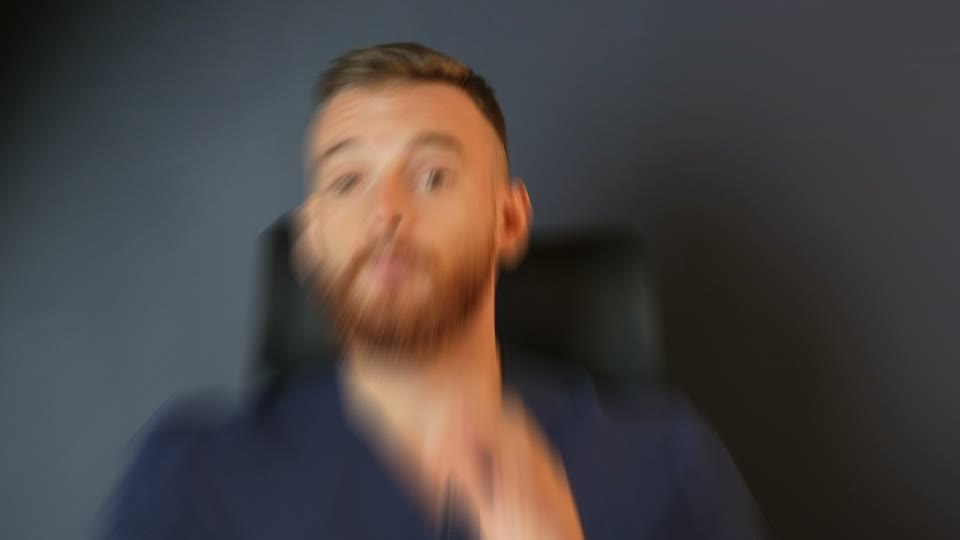

- **Cosa fa:** zoom rapido sugli occhi con la sfocatura di movimento e un piccolo superamento
- **Quando:** una parola che pesa («dico»)
- **Quando no:** su frasi lunghe
- **Reference:** gadzhi-04
- **Ultimo voto:** 7 (campionario v2, minimo 6)
- **Nel motore:** `{"camera": ["mosse"]}`
- **Origine:** campionario v1 e v2

### Taglio con lampo (`lampo`, attivo)

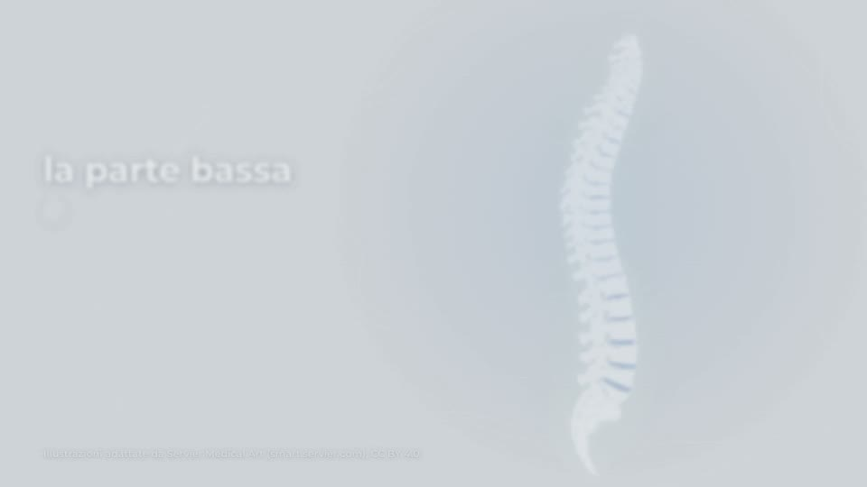

- **Cosa fa:** lampo di luce panna/verde di 3-4 frame fra lui e una scena scura
- **Quando:** entrata in una scena scura a tutto schermo
- **Quando no:** fra due momenti sul girato
- **Reference:** martell-02
- **Ultimo voto:** parte dei momenti a 7 (YT_POSTURA_32)
- **Nel motore:** `{"piatto": ["lampo"]}`
- **Origine:** YT_POSTURA_32

### Lui nel cerchio (`lui-nel-cerchio`, attivo)

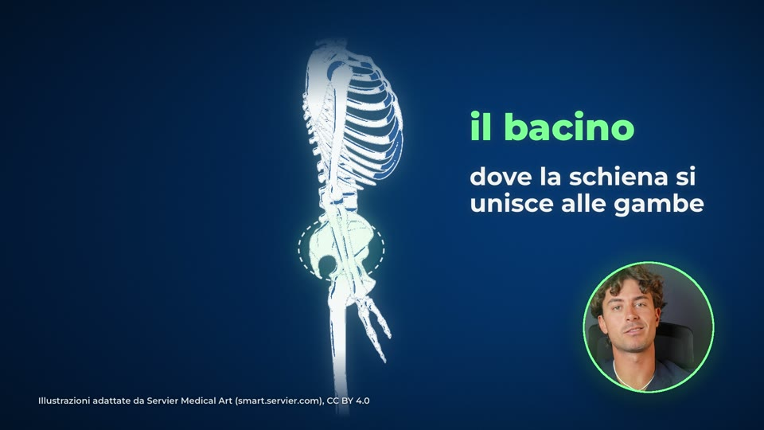

- **Cosa fa:** il quadro di lui si stacca, diventa un rettangolo tondo e poi un cerchio nell'angolo con l'anello verde; dietro entra la scena scura con il disegno
- **Quando:** passaggio da lui a una scena scura con un disegno Servier mentre lui continua a parlare
- **Quando no:** senza una scena scura dietro
- **Reference:** gadzhi-09
- **Ultimo voto:** 7 (campionario v3)
- **Nel motore:** `{"piatto": ["finestra.cerchio"]}`
- **Origine:** campionario v3
- **Nota:** fase 7c: la finestra si compone SOPRA gli strati del disegno (scena.componi), così lo scheletro entra mentre lui si stringe; prima entrava a cerchio già nell'angolo

### Finestra inclinata sul fondo del brand (`finestra-inclinata`, attivo)

- **Cosa fa:** il quadro diventa una finestra inclinata sul fondo del brand, con spazio grande per un testo forte
- **Quando:** call to action, link in descrizione
- **Quando no:** nei momenti di contenuto
- **Reference:** martell-06
- **Ultimo voto:** 8 (MR_POSTURA_01_v4, direttore, 02/11/2026)
- **Nel motore:** `{"piatto": ["finestra.inclina"]}`
- **Origine:** campionario v2, MR_POSTURA_01_v3

### B-roll pieno o in sequenza (`b-roll`, attivo)

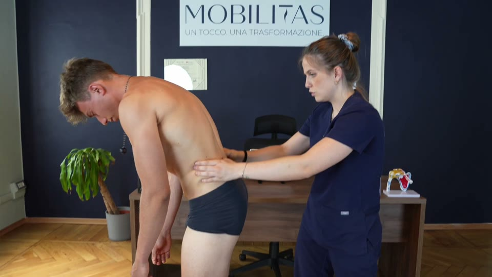

- **Cosa fa:** clip della libreria a tutto schermo o in sequenza, rallentate all'83%, senza audio, con un fruscio
- **Quando:** quando lui descrive una situazione
- **Quando no:** clip escluse dall'indice; mai sopra testo
- **Reference:** —
- **Ultimo voto:** —
- **Nel motore:** `{"regia": ["broll"]}`
- **Origine:** prima generazione, YT_POSTURA_32

## testo sulla scena

### Frase sul corpo (`frase-sul-corpo`, attivo)

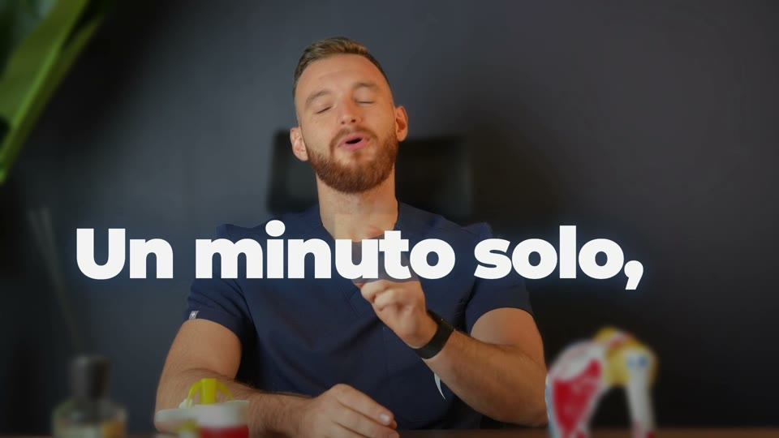

- **Cosa fa:** una o due parole enormi (800-900) sul busto, parola per parola sulla voce, le mani passano davanti alle lettere
- **Quando:** aggancio, una parola chiave da far pesare
- **Quando no:** frasi lunghe; quando le mani coprono troppo
- **Reference:** martell-02
- **Ultimo voto:** 8 (MR_POSTURA_01_v4, direttore, 02/11/2026)
- **Nel motore:** `{"modello": "parole"}`
- **Origine:** campionario v1 e v2
- **Nota:** fase 7c: ogni parola nasce sfocata e al 40% (5 frame) mentre sale dalla maschera: il primo frame non mostra piu solo le cime delle aste («U» -> «- -», direttore v4)

### Titolo dietro di lui (`titolo-dietro`, attivo)

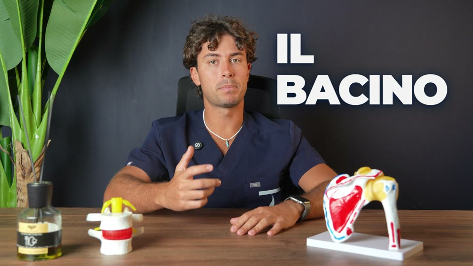

- **Cosa fa:** il titolo di un capitolo passa dietro la persona (sagoma di Vision): minuscolo con il punto e la parola chiave in gradiente verde → azzurro, come il sito
- **Quando:** inizio di un capitolo, con le sue parole
- **Quando no:** testi lunghi; quando lui copre più del 15%
- **Reference:** martell-02
- **Ultimo voto:** 7 (YT_POSTURA_32)
- **Nel motore:** `{"modello": "titolo_dietro"}`
- **Origine:** prima generazione (Pillow), poi YT_POSTURA_32
- **Nota:** dal 01/11/2026 forma del sito (brand.json -> titoli): minuscolo con il punto, -0,045 em, interlinea 0,92, `dati.chiave` = parole in gradiente (default l'ultima riga). Il posto dietro di lui lo misura impagina.piazza_titolo sulle righe minuscole; se non trova un posto coperto 4-12% resta sulla parete (si segnala)

### Titolo dietro di lui (maiuscolo) (`titolo-dietro-maiuscolo`, variante)

- **Cosa fa:** la versione di YT_POSTURA_32: titolo in MAIUSCOLO 900, tutto panna, passa dietro la persona
- **Quando:** —
- **Quando no:** —
- **Reference:** martell-02
- **Ultimo voto:** 7 (YT_POSTURA_32)
- **Nel motore:** `{"modello": "titolo_dietro", "dati": {"forma": "maiuscolo"}}`
- **Origine:** YT_POSTURA_32 (principale fino al 31/10/2026)
- **Variante di:** `titolo-dietro`
- **Nota:** variante dal 01/11/2026: il titolo principale segue il sito (minuscolo con il punto e la chiave in gradiente)

### Frase chiave nel vetro (più luce) (`frase-chiave-vetro`, attivo)

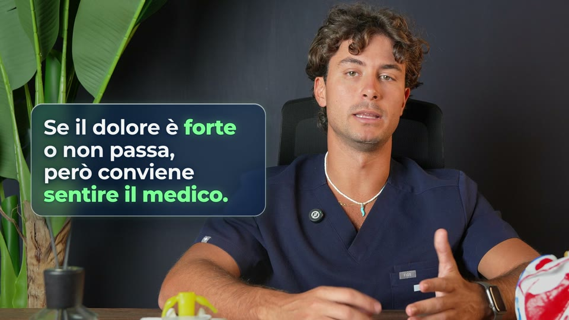

- **Cosa fa:** frase parola per parola dentro un vetro che sfoca lo studio, tinta blu, bordo di luce, riflesso diagonale, alone verde in entrata
- **Quando:** le frasi chiave (versione B scelta da Riccardo)
- **Quando no:** davanti al muro scuro: il vetro si legge come un riquadro
- **Condizioni (controllate dal motore):** vetro_zona_ricca
- **Reference:** martell-06
- **Ultimo voto:** 7 (campionario v3)
- **Nel motore:** `{"modello": "frase_luce", "dati": {"vetro": {"forte": true}}}`
- **Origine:** campionario v3

### Frase chiave nel vetro (classica) (`frase-chiave-vetro-classico`, variante)

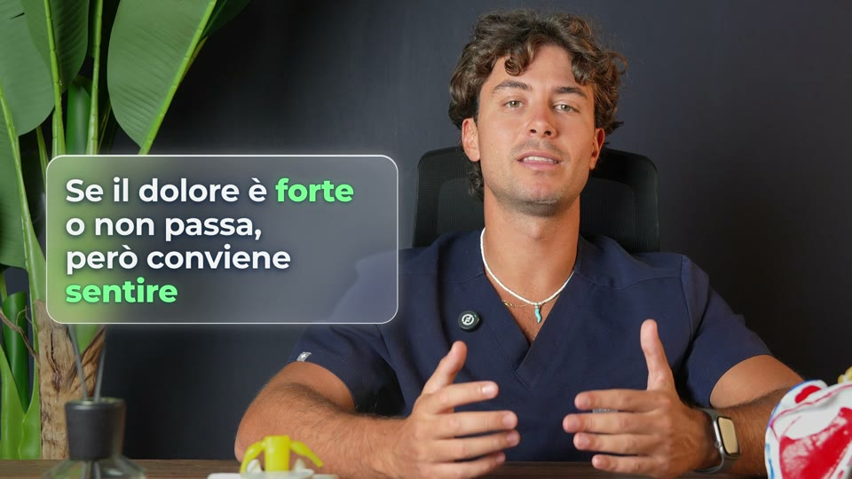

- **Cosa fa:** la versione di YT_POSTURA_32: vetro chiaro che schiarisce lo studio
- **Quando:** —
- **Quando no:** —
- **Reference:** martell-06
- **Ultimo voto:** 6-7 (YT_POSTURA_32)
- **Nel motore:** `{"modello": "frase_luce", "dati": {"vetro": {}}}`
- **Origine:** YT_POSTURA_32
- **Variante di:** `frase-chiave-vetro`

### Frase chiave nel pannello (versione A) (`frase-chiave-pannello`, variante)

- **Cosa fa:** pannello blu al bordo del quadro con la frase che sale riga per riga
- **Quando:** —
- **Quando no:** Riccardo ha scelto la versione B (vetro)
- **Reference:** martell-07
- **Ultimo voto:** — (campione tappa 2)
- **Nel motore:** `{"modello": "frase_chiave"}`
- **Origine:** campione di YT_POSTURA_32
- **Variante di:** `frase-chiave-vetro`

### Equazione detta (`equazione`, attivo)

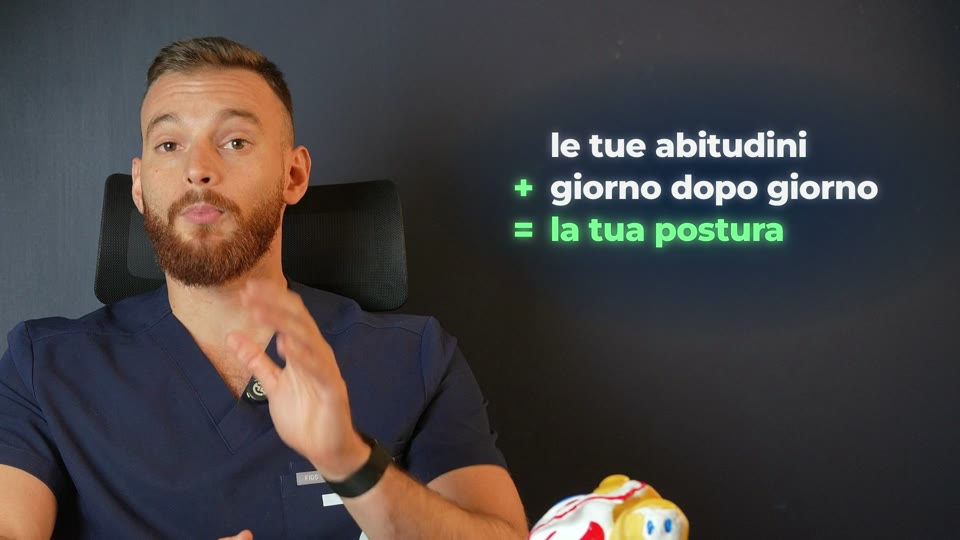

- **Cosa fa:** testo laterale: i termini detti si decifrano sulla voce, + e = verdi, esce cancellandosi all'indietro
- **Quando:** due o tre cose dette che si sommano in una conseguenza
- **Quando no:** sulla pianta o sul legno: sempre sulla parete libera con il velo blu
- **Reference:** gadzhi-10, gadzhi-13
- **Ultimo voto:** 8 (MR_POSTURA_01_v4, direttore, 02/11/2026)
- **Nel motore:** `{"modello": "equazione"}`
- **Origine:** campionario v3
- **Nota:** fase 7c: decifra = 'minuscole' per i termini lunghi (le maiuscole e i simboli provvisori allargano la parola di un terzo)

### Equazione detta (ads 9:16, nella finestra) (`equazione-finestra`, attivo)

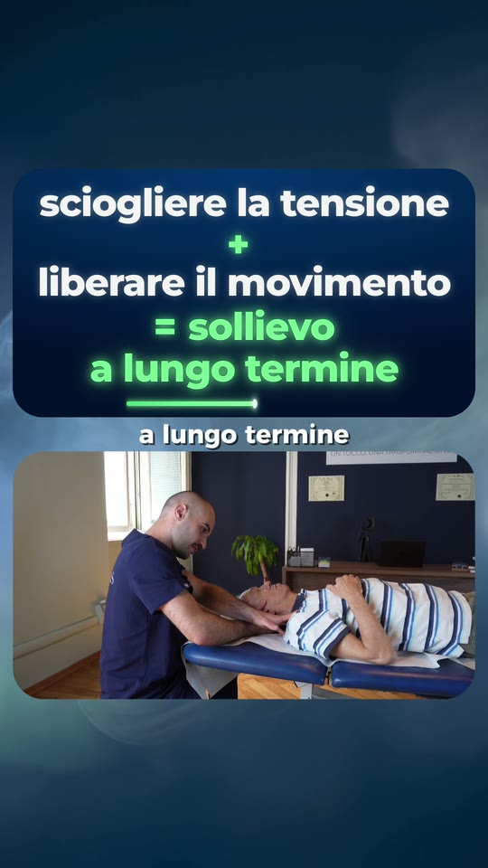

- **Cosa fa:** l'equazione detta dentro la finestra grande in alto del video ads, al posto del B-roll: termini centrati che si decifrano sulla parola (solo lettere), + e = verdi, risultato verde con colpo di luce e barra che cresce; il blocco resta centrato in ogni stato; esce cancellandosi all'indietro
- **Quando:** ads 9:16: quando la voce mette insieme due cose che danno un risultato («sciogliere la tensione + liberare il movimento = sollievo»)
- **Quando no:** termini piu larghi di ~930 px a corpo 84; inquadrature di schema C
- **Reference:** gadzhi-10/13
- **Ultimo voto:** 8 (AD_CERVICALGIA_AI-Barontini, direttore, giro 2, 04/11/2026; giro 1: 7)
- **Nel motore:** `{"modello": "equazione_ads", "dati": {"modo": "finestra", "rett": "la finestra grande in alto, misurata sui pixel per inquadratura", "corpo": 84}}`
- **Origine:** laboratorio, fase 3 notte (04/11/2026), AD_CERVICALGIA_AI-Barontini
- **Variante di:** `equazione`
- **Nota:** approvata da Riccardo il 04/11/2026 (fase 3 ads, dopo l'anteprima completa). Modello nuovo in motore/inserti/scene/ (il modello di partenza resta com'e); riconosciuta da catalogo.identifica.

### Equazione detta (ads 9:16, nella finestra), variante 2 (`equazione-finestra-v2`, variante)

- **Cosa fa:** l'equazione detta dentro la finestra grande in alto del video ads, al posto del B-roll: termini centrati che si decifrano sulla parola (solo lettere), + e = verdi, risultato verde con colpo di luce e barra che cresce; il blocco resta centrato in ogni stato; esce cancellandosi all'indietro Variante 2: il fondo pieno della finestra entra a taglio al primo fotogramma e nessun termine parte prima del fotogramma dopo (mai testo sopra il B-roll). Giro 3: uscita «cancella» a parole intere, t_via calcolato dal modello: l'ultimo fotogramma mostra la prima parola intera, mai una parola a meta.
- **Quando:** ads 9:16: quando la voce mette insieme due cose che danno un risultato («sciogliere la tensione + liberare il movimento = sollievo»)
- **Quando no:** termini piu larghi di ~930 px a corpo 84; inquadrature di schema C
- **Reference:** gadzhi-10/13
- **Ultimo voto:** 6 (AD_CERVICALGIA, direttore cieco, giro 3, 04/11/2026; giri 1 e 2: 6): l'uscita va a parole intere come chiesto; il direttore vorrebbe l'uscita a taglio con l'equazione intera (l'uscita «cancella» e una scelta approvata). Sotto 7: tenuta come migliore versione (report collaudo)
- **Nel motore:** `{"modello": "equazione_ads2", "dati": {"modo": "finestra", "rett": "la finestra grande in alto, misurata sui pixel per inquadratura", "corpo": 84}, "usa": ["equazione_ads"]}`
- **Origine:** laboratorio, fase 5 (04/11/2026): correzione di un difetto trovato dal direttore nella fase 4
- **Variante di:** `equazione-finestra`
- **Nota:** IN PROVA: diventa attiva solo con l'ok di Riccardo; fino ad allora i piani dei nuovi ads la usano al posto di «equazione-finestra», segnata «in prova». Correzione: il fondo pieno della finestra entra a taglio al primo fotogramma e nessun termine parte prima del fotogramma dopo (mai testo sopra il B-roll). Modello motore/inserti/scene/equazione_ads2.js (copia di quello di partenza, che resta com'e). Giro 3: uscita «cancella» a parole intere, t_via calcolato dal modello: l'ultimo fotogramma mostra la prima parola intera, mai una parola a meta.

### Connettore (`connettore`, attivo)

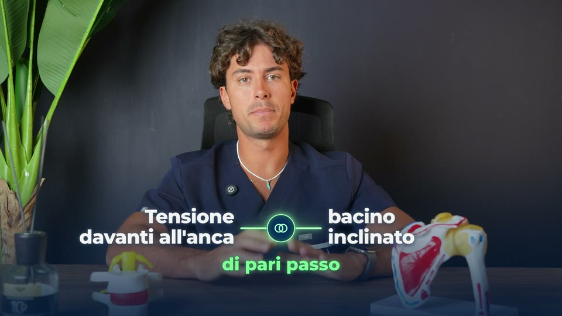

- **Cosa fa:** due etichette basse unite da una linea luminosa che si disegna dal centro, nodo con due anelli e le sue parole sotto
- **Quando:** due cose che lui lega («vanno di pari passo», «dipende da»)
- **Quando no:** quando sotto ci sono mani, oggetti o modellini
- **Condizioni (controllate dal motore):** zona_libera
- **Reference:** gadzhi-11
- **Ultimo voto:** 7 (campionario v3)
- **Nel motore:** `{"modello": "connettore"}`
- **Origine:** campionario v3

### Chip con nome e ruolo (`chip`, attivo)

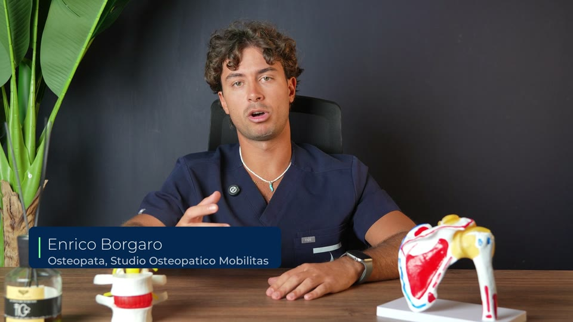

- **Cosa fa:** nome e ruolo di chi parla; dal 01/11/2026 con il pittogramma su un disco panna
- **Quando:** alla presentazione
- **Quando no:** nomi non confermati dai materiali
- **Reference:** —
- **Ultimo voto:** —
- **Nel motore:** `{"grafica": ["chip"]}`
- **Origine:** prima generazione
- **Nota:** regia.chip.stile: v3 = pittogramma su disco panna, nome 700, ruolo al 70% (v2 resta per i video vecchi)

### Connettore (ads 9:16, nella finestra) (`connettore-finestra`, variante)

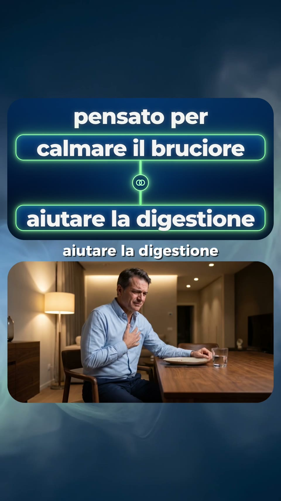

- **Cosa fa:** nella finestra grande in alto, al posto del B-roll: «pensato per» in testa, due etichette dette in colonna unite da una linea verde che si disegna dal centro con un nodo luminoso; poi le etichette escono e il risultato detto entra in verde con una barra che cresce
- **Quando:** ads 9:16: due azioni dette che portano allo stesso scopo («calmare il bruciore, aiutare la digestione e darti un sollievo»)
- **Quando no:** etichette piu larghe di ~880 px a corpo 84; inquadrature di schema C
- **Reference:** gadzhi-11, gadzhi-13
- **Ultimo voto:** 7 (AD_REFLUSSO giro 1); 6 (AD_COLON giro 2, senza risultato: chiusa sul taglio per non coprire un sottotitolo)
- **Nel motore:** `{"modello": "connettore_ads", "usa": [], "dati": {"rett": "finestra grande misurata (lista sul taglio)", "corpo": 84}}`
- **Origine:** laboratorio, collaudo AD_REFLUSSO (04/11/2026): modello nuovo per gli ads, da un modello del catalogo
- **Variante di:** `connettore`
- **Nota:** IN PROVA: modello nuovo per gli ads 9:16, costruito dopo l'ok di Riccardo al piano di AD_REFLUSSO (04/11/2026); diventa attivo solo con il suo ok. Modello motore/inserti/scene/connettore_ads.js (quello di partenza resta com'e).

### Parole una per volta (ads 9:16, nella finestra) (`parole-finestra`, variante)

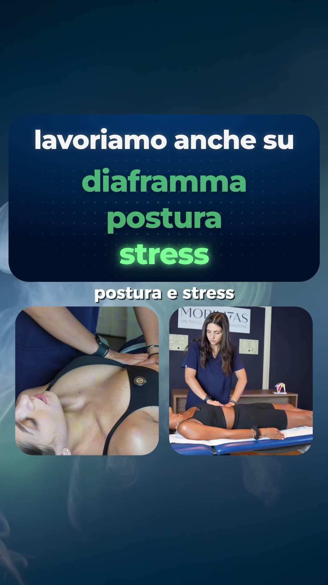

- **Cosa fa:** nella finestra grande: una riga panna di apertura, poi parole dette che nascono grigie e sfocate e diventano verdi con bagliore sulla voce, una dopo l'altra; retino leggero e camera lenta
- **Quando:** ads 9:16: un elenco breve di parole dette («diaframma, postura e stress»)
- **Quando no:** frasi lunghe; inquadrature di schema C
- **Reference:** martell-07, martell-03
- **Ultimo voto:** 7 (AD_EMICRANIA, AD_BRUXISMO giro 2); AD_REFLUSSO: 7 e poi 6 sulla stessa grafica
- **Nel motore:** `{"modello": "parole_ads", "usa": [], "dati": {}}`
- **Origine:** laboratorio, collaudo AD_REFLUSSO (04/11/2026): modello nuovo per gli ads, da un modello del catalogo
- **Variante di:** `schermata`
- **Nota:** IN PROVA: modello nuovo per gli ads 9:16, costruito dopo l'ok di Riccardo al piano di AD_REFLUSSO (04/11/2026); diventa attivo solo con il suo ok. Modello motore/inserti/scene/parole_ads.js (quello di partenza resta com'e).

### Fumetto (ads 9:16, nella finestra) (`fumetto-finestra`, variante)

- **Cosa fa:** un fumetto di chat chiaro con coda nella finestra grande: nasce sfocato con i tre puntini, poi diventa nitido con la frase detta, piccolo rimbalzo
- **Quando:** ads 9:16: una frase che altri hanno detto ai pazienti («ci devi convivere»)
- **Quando no:** messaggi dello studio; inquadrature di schema C
- **Reference:** martell-05
- **Ultimo voto:** 7 (AD_REFLUSSO, AD_COLON)
- **Nel motore:** `{"modello": "fumetto_ads", "usa": [], "dati": {}}`
- **Origine:** laboratorio, collaudo AD_REFLUSSO (04/11/2026): modello nuovo per gli ads, da un modello del catalogo
- **Variante di:** `fumetti`
- **Nota:** IN PROVA: modello nuovo per gli ads 9:16, costruito dopo l'ok di Riccardo al piano di AD_REFLUSSO (04/11/2026); diventa attivo solo con il suo ok. Modello motore/inserti/scene/fumetto_ads.js (quello di partenza resta com'e).

### Aggancio (ads 9:16, nella finestra) (`aggancio-finestra`, variante)

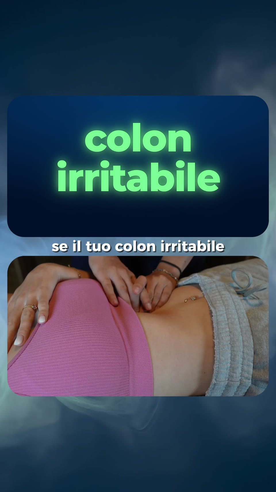

- **Cosa fa:** nella finestra grande dei primi secondi: il disturbo in parola chiave a gradiente pieno dal fotogramma 0, poi le frasi dette sullo specialista, il pittogramma in un disco
- **Quando:** ads 9:16: i primi secondi, sul disturbo e sullo specialista, leggibile dal fotogramma 0
- **Quando no:** «il tuo / la tua» insieme al disturbo; decifrazioni o sfocature al primo fotogramma
- **Reference:** martell-02, gadzhi-04, martell-07
- **Ultimo voto:** 7 (AD_COLON giro 2; preferita dal direttore alla versione tutto schermo)
- **Nel motore:** `{"modello": "aggancio_ads", "usa": [], "dati": {"modo": "finestra"}}`
- **Origine:** laboratorio, prova dell'aggancio su AD_COLON (04/11/2026)
- **Variante di:** `frase-sul-corpo`
- **Nota:** IN PROVA: prova chiesta da Riccardo (04/11/2026), versione A finestra e B tutto schermo breve; diventa attiva solo con il suo ok. Modello motore/inserti/scene/aggancio_ads.js

### Aggancio (ads 9:16, tutto schermo breve) (`aggancio-9x16`, variante)

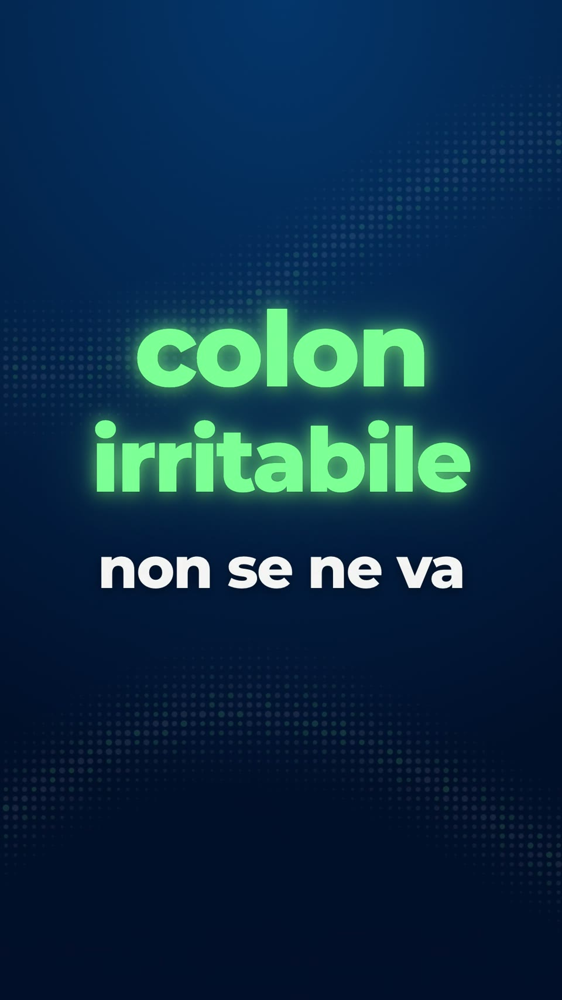

- **Cosa fa:** 1,5-2 s di schermata piena dal fotogramma 0: il disturbo grande a gradiente, il pittogramma, una riga detta; poi il video base
- **Quando:** ads 9:16: i primi secondi, sul disturbo e sullo specialista, leggibile dal fotogramma 0
- **Quando no:** «il tuo / la tua» insieme al disturbo; decifrazioni o sfocature al primo fotogramma
- **Reference:** martell-02, gadzhi-04, martell-07
- **Ultimo voto:** 7 (AD_COLON giro 2)
- **Nel motore:** `{"modello": "aggancio_ads", "usa": [], "dati": {"modo": "tutto"}}`
- **Origine:** laboratorio, prova dell'aggancio su AD_COLON (04/11/2026)
- **Variante di:** `frase-sul-corpo`
- **Nota:** IN PROVA: prova chiesta da Riccardo (04/11/2026), versione A finestra e B tutto schermo breve; diventa attiva solo con il suo ok. Modello motore/inserti/scene/aggancio_ads.js

## numeri

### Numero gigante dietro di lui (`numero-dietro`, attivo)

- **Cosa fa:** un numero detto da lui, enorme, dietro la persona (sagoma di Vision), che conta e frena sulla parola
- **Quando:** un numero detto (recensioni, addominali, ore)
- **Quando no:** numeri non detti, percentuali di risultato
- **Reference:** martell-02, gadzhi-03
- **Ultimo voto:** 8 (MR_POSTURA_01_v4, direttore, 02/11/2026)
- **Nel motore:** `{"modello": "numero_dietro"}`
- **Origine:** campionario v1 e v2

### Linea del tempo luminosa (`linea-tempo`, attivo)

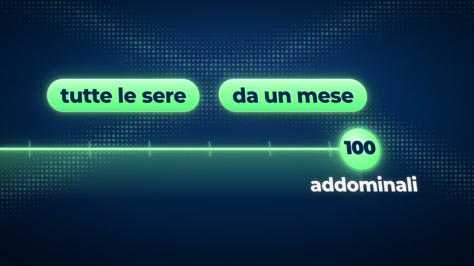

- **Cosa fa:** scena scura: un nodo verde disegna una linea mentre la percorre, la camera lo segue inclinata, pillole con le sue parole
- **Quando:** solo quando lui dice un tempo o una durata
- **Quando no:** per inventare un dato o una curva
- **Condizioni (controllate dal motore):** tempo_detto
- **Reference:** gadzhi-07
- **Ultimo voto:** 6 (campionario v3)
- **Nel motore:** `{"modello": "linea_tempo"}`
- **Origine:** campionario v3

## scene scure

### Schermata su fondo blu vero (`schermata`, attivo)

- **Cosa fa:** frase a tutto schermo su fondo blu pieno con il retino, parole che nascono sfocate e si accendono, colpo di scala sulla chiave
- **Quando:** frasi che chiudono un passaggio
- **Quando no:** più di due per video
- **Reference:** martell-07
- **Ultimo voto:** 8 (MR_POSTURA_01_v4, direttore, 02/11/2026)
- **Nel motore:** `{"modello": "schermata", "dati": {"fondo": "pieno"}}`
- **Origine:** campionario v3 (principale dal 01/11/2026)
- **Nota:** dal 01/11/2026: fondo del sito, parole minuscole con il punto, chiave in gradiente con la luce verde; chiavi di fila sulla stessa riga con un gradiente continuo

### Schermata sul velo (classica) (`schermata-velo`, variante)

- **Cosa fa:** frase a tutto schermo su un velo blu sopra il girato sfocato, parole che salgono dalle maschere, filigrana MOBILITAS
- **Quando:** quando si vuole lasciare intravedere lui
- **Quando no:** —
- **Reference:** martell-07
- **Ultimo voto:** 6 (YT_POSTURA_32)
- **Nel motore:** `{"modello": "schermata"}`
- **Origine:** campionario v1 e v2, YT_POSTURA_32
- **Variante di:** `schermata`

## liste

### Etichette barrate (più luce) (`etichette-barrate`, attivo)

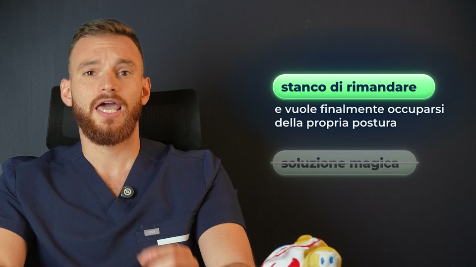

- **Cosa fa:** pillole piene di luce verde con il testo blu notte; la barra blu notte le barra sulla parola e restano accese
- **Quando:** i tentativi o le idee che lui smonta
- **Quando no:** cose che non smonta
- **Reference:** martell-01
- **Ultimo voto:** 8 (MR_POSTURA_01_v4, direttore, 02/11/2026)
- **Nel motore:** `{"modello": "etichette_luce", "dati": {"luce": "forte"}}`
- **Origine:** campionario v3 (principale dal 01/11/2026)
- **Nota:** fase 7c: barra = 'panna' -> barra panna che sporge e pillola barrata che scende al 38% e perde colore (sulla pillola verde la barra blu notte non si distingueva)

### Etichette barrate (classiche) (`etichette-barrate-classiche`, variante)

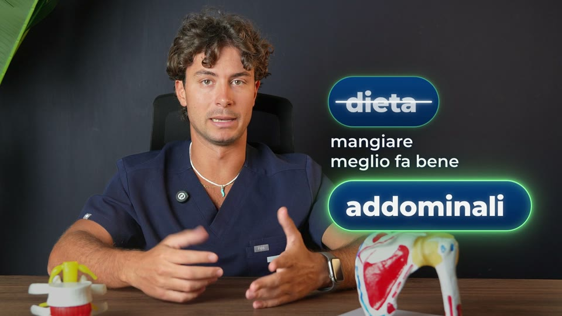

- **Cosa fa:** pillole blu notte con bordo e bagliore verdi; barrate si spengono
- **Quando:** —
- **Quando no:** —
- **Reference:** martell-01
- **Ultimo voto:** 7 (YT_POSTURA_32)
- **Nel motore:** `{"modello": "etichette_luce", "dati": {"luce": "classica"}}`
- **Origine:** YT_POSTURA_32
- **Variante di:** `etichette-barrate`

### Etichette barrate (ads 9:16, nella finestra) (`etichette-barrate-finestra`, attivo)

- **Cosa fa:** le pillole di etichette-barrate dentro la finestra grande in alto del video ads (schemi A e B), al posto del B-roll, con lo stesso rettangolo e gli stessi angoli; fondo del sito; barra panna piena lunga quanto la pillola che resta all'85%, pillola barrata al 55%
- **Quando:** ads 9:16: due o tre cose che la voce nega o smonta («niente medicine», «niente esercizi»), su un'inquadratura di schema A o B
- **Quando no:** inquadrature di schema C; testi più larghi di 950 px al corpo minimo (1,5 volte il sottotitolo)
- **Reference:** martell-01
- **Ultimo voto:** 8 (AD_CERVICALGIA_AI-Barontini, direttore, giro 2, 03/11/2026)
- **Nel motore:** `{"modello": "etichette_ads", "usa": ["etichette_luce"], "dati": {"modo": "finestra", "rett": "la finestra grande in alto, misurata sui pixel", "luce": "forte", "barra": "panna", "barra_px": 10, "barra_resta": 0.85, "barrata": 0.55}}`
- **Origine:** laboratorio, fase 1 (03/11/2026), AD_CERVICALGIA_AI-Barontini inquadratura 8
- **Variante di:** `etichette-barrate`
- **Nota:** approvata da Riccardo il 03/11/2026 (fase 1 ads, V1). Modello motore/inserti/scene/etichette_ads.js (chiama etichette_luce senza modificarlo); pagina 1080x1920 da motore/motore/reel_grafiche.py; barra panna; riconosciuta da catalogo.identifica.

### Etichette barrate (ads 9:16, nella finestra), variante 2 (`etichette-barrate-finestra-v2`, variante)

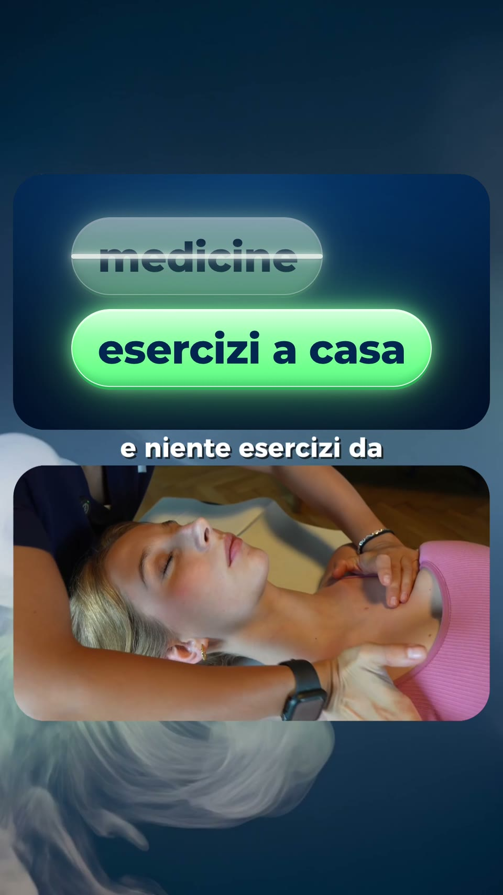

- **Cosa fa:** le pillole di etichette-barrate dentro la finestra grande in alto del video ads (schemi A e B), al posto del B-roll, con lo stesso rettangolo e gli stessi angoli; fondo del sito; barra panna piena lunga quanto la pillola che resta all'85%, pillola barrata al 55% Variante 2: il fondo entra ed esce a taglio, le pillole dentro il fondo pieno (niente doppia immagine con il B-roll). Giro 3: le pillole restano nitide fino al taglio (niente uscita sfocata).
- **Quando:** ads 9:16: due o tre cose che la voce nega o smonta («niente medicine», «niente esercizi»), su un'inquadratura di schema A o B
- **Quando no:** inquadrature di schema C; testi più larghi di 950 px al corpo minimo (1,5 volte il sottotitolo)
- **Reference:** martell-01
- **Ultimo voto:** 7 (AD_CERVICALGIA, direttore cieco, giro 3, 04/11/2026; giri 1 e 2: 6): uscita nitida fino al taglio
- **Nel motore:** `{"modello": "etichette_ads2", "usa": ["etichette_luce", "etichette_ads"], "dati": {"modo": "finestra", "rett": "la finestra grande in alto, misurata sui pixel", "luce": "forte", "barra": "panna", "barra_px": 10, "barra_resta": 0.85, "barrata": 0.55}}`
- **Origine:** laboratorio, fase 5 (04/11/2026): correzione di un difetto trovato dal direttore nella fase 4
- **Variante di:** `etichette-barrate-finestra`
- **Nota:** IN PROVA: diventa attiva solo con l'ok di Riccardo; fino ad allora i piani dei nuovi ads la usano al posto di «etichette-barrate-finestra», segnata «in prova». Correzione: il fondo entra ed esce a taglio, le pillole dentro il fondo pieno (niente doppia immagine con il B-roll). Modello motore/inserti/scene/etichette_ads2.js (copia di quello di partenza, che resta com'e). Giro 3: le pillole restano nitide fino al taglio (niente uscita sfocata).

### Etichette barrate (ads 9:16, tutto schermo) (`etichette-barrate-9x16`, variante)

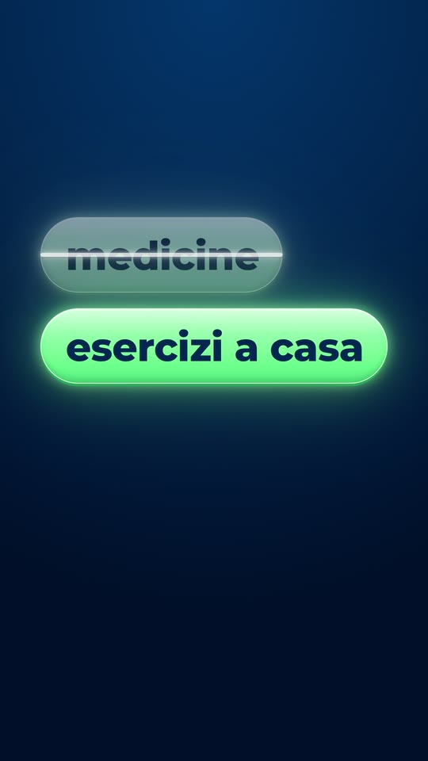

- **Cosa fa:** le pillole di etichette-barrate in colonna, più grandi, su tutto il quadro 9:16 (fondo del sito), sottotitoli coperti per la durata della grafica
- **Quando:** ads 9:16, quando la lista ha bisogno di tutto lo schermo
- **Quando no:** inquadrature con le animazioni 3D; quando i sottotitoli devono restare
- **Reference:** martell-01
- **Ultimo voto:** 6 (AD_CERVICALGIA_AI-Barontini, direttore, giro 2, 03/11/2026: limite di impostazione)
- **Nel motore:** `{"modello": "etichette_ads", "usa": ["etichette_luce"], "dati": {"modo": "pieno", "luce": "forte", "barra": "panna", "barra_px": 10, "barra_resta": 0.85, "barrata": 0.55}}`
- **Origine:** laboratorio, fase 1 (03/11/2026), AD_CERVICALGIA_AI-Barontini inquadratura 8
- **Variante di:** `etichette-barrate`
- **Nota:** variante (fase 1 ads, 03/11/2026): «tutto schermo» solo quando il contenuto riempie davvero lo schermo; con una o due pillole si usa etichette-barrate-finestra. Modello etichette_ads; riconosciuta da catalogo.identifica.

### Etichette barrate (ads 9:16, tutto schermo con i sottotitoli visibili) (`etichette-barrate-9x16-sottotitoli`, variante)

- **Cosa fa:** come etichette-barrate-9x16, ma la fascia dei sottotitoli resta trasparente (si vedono i sottotitoli del video base); le pillole stanno sopra la fascia
- **Quando:** ads 9:16 tutto schermo quando i sottotitoli devono restare
- **Quando no:** inquadrature con le animazioni 3D
- **Reference:** martell-01
- **Ultimo voto:** 4 (AD_CERVICALGIA_AI-Barontini, direttore, giro 2, 03/11/2026: limite di impostazione)
- **Nel motore:** `{"modello": "etichette_ads", "usa": ["etichette_luce"], "dati": {"modo": "pieno", "fascia": [921, 1013], "luce": "forte", "barra": "panna", "barra_px": 10, "barra_resta": 0.85, "barrata": 0.55}}`
- **Origine:** laboratorio, fase 1 (03/11/2026), AD_CERVICALGIA_AI-Barontini inquadratura 8
- **Variante di:** `etichette-barrate`
- **Nota:** variante da non usare (Riccardo, 03/11/2026): la fascia trasparente per i sottotitoli non si usa. Modello etichette_ads; riconosciuta da catalogo.identifica.

### Lista dei tentativi (`tentativi`, variante)

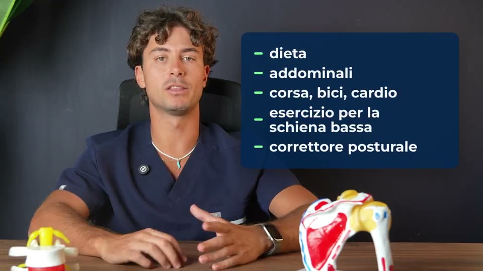

- **Cosa fa:** colonna di voci con tratto che le barra
- **Quando:** —
- **Quando no:** —
- **Reference:** martell-01
- **Ultimo voto:** — (campione tappa 2)
- **Nel motore:** `{"modello": "tentativi"}`
- **Origine:** YT_POSTURA_32 tappa 1
- **Variante di:** `etichette-barrate`

### Riga di icone in basso (`riga-icone`, attivo)

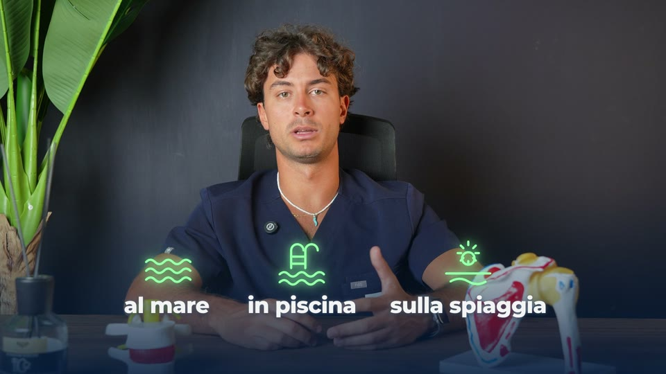

- **Cosa fa:** icone lineari verdi che si disegnano sulla parola con l'etichetta sotto, velo blu dal basso
- **Quando:** tre luoghi, oggetti o momenti detti in fila
- **Quando no:** quando la parte bassa ha mani, oggetti o modellini; figure umane
- **Condizioni (controllate dal motore):** zona_libera
- **Reference:** gadzhi-14
- **Ultimo voto:** 7 (campionario v3)
- **Nel motore:** `{"modello": "riga_icone"}`
- **Origine:** campionario v3

### Card che si accendono (`card-accese`, attivo)

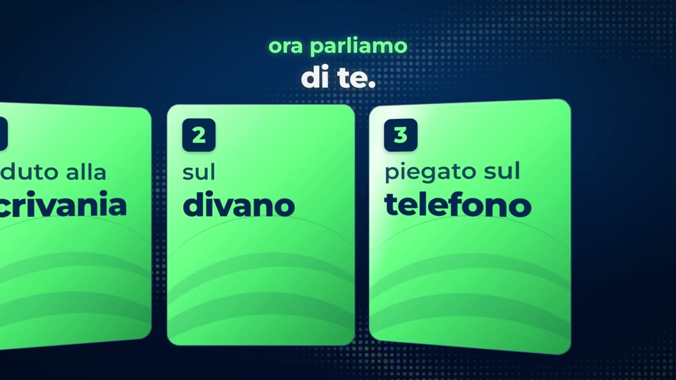

- **Cosa fa:** scena scura: tre card 3D arrivano nascoste con una scansione e si accendono quando lui le nomina, poi riepilogo
- **Quando:** elenchi di tre cose annunciate prima
- **Quando no:** elenchi lunghi
- **Reference:** gadzhi-08/09/12/15
- **Ultimo voto:** 8 (MR_POSTURA_01_v4, direttore, 02/11/2026)
- **Nel motore:** `{"modello": "card_accese"}`
- **Origine:** campionario v3
- **Nota:** fase 7c: cifre = false toglie le cifre a contorno (il «1» si leggeva come una freccia)

### Card che si accendono (ads 9:16, tutto schermo) (`card-accese-9x16`, attivo)

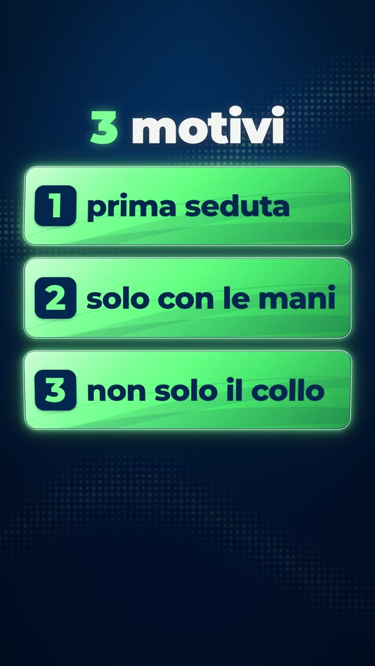

- **Cosa fa:** le card di card-accese una sotto l'altra su tutto il quadro 9:16: titolo che si decifra, card che arrivano spente con la scansione, a ogni «primo/secondo/terzo» la scena torna e si accende la card giusta (le altre sotto un velo blu), riepilogo finale; fra un ritorno e l'altro il video base
- **Quando:** ads 9:16: elenchi di tre cose annunciate prima («3 motivi»), quando il contenuto riempie davvero lo schermo
- **Quando no:** inquadrature con le animazioni 3D; elenchi lunghi; testi delle card più larghi di ~730 px a corpo 87
- **Reference:** gadzhi-08/09/12/15
- **Ultimo voto:** 9 (AD_CERVICALGIA_AI-Barontini, direttore, giro 3, 03/11/2026; giri 1-2: 7, 8)
- **Nel motore:** `{"modello": "card_accese_ads", "usa": ["card_accese"], "dati": {"apparizioni": "[{s, e, esce}] a tutto schermo, in mezzo il video base", "titolo": "{cifra, testo, t}", "carte": "[{num, t_num, chiave, t_chiave, t_stato}]", "t_riepilogo": "s", "corpo": 87, "velo": 0.48, "lucine": "[t]", "pulsa": "[t0, t1]"}}`
- **Origine:** laboratorio, fase 2 (03/11/2026), AD_CERVICALGIA_AI-Barontini 18–40 s
- **Variante di:** `card-accese`
- **Nota:** approvata da Riccardo il 03/11/2026 (fase 2 ads, dopo il giro 3). Modello motore/inserti/scene/card_accese_ads.js (rifatto su card_accese, che resta com'e); numeri nel riquadro, niente cifre a contorno; decifraStretto: caratteri provvisori solo lettere (mai cifre, niente aste sole i/l/j), della stessa larghezza; alone sulla card accesa (maschera della scansione tolta a entrata finita); velo 48% sulle card in secondo piano; riconosciuta da catalogo.identifica.

### Card con spessore (`card-con-spessore`, attivo)

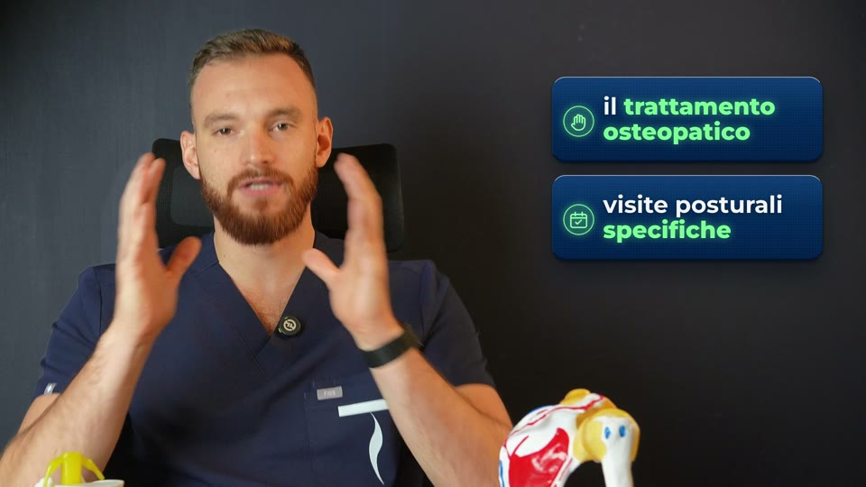

- **Cosa fa:** card blu notte con spessore, una ogni 0,25 s, con icona o ritaglio Servier
- **Quando:** elenchi brevi accanto a lui
- **Quando no:** sopra mani o volto
- **Reference:** gadzhi-06
- **Ultimo voto:** 8 (MR_POSTURA_01_v4, direttore, 02/11/2026)
- **Nel motore:** `{"modello": "card_spessore"}`
- **Origine:** YT_POSTURA_32
- **Nota:** ; fase 7c: senza disegno Servier, `icona` (lineare verde su disco blu notte); attenzione: il testo deve stare in due righe (la card taglia il testo che va a capo una terza volta, e il controllo «lettere intere» non lo vede)

### Card con spessore (ads 9:16, tutto schermo a momenti) (`card-con-spessore-9x16`, attivo)

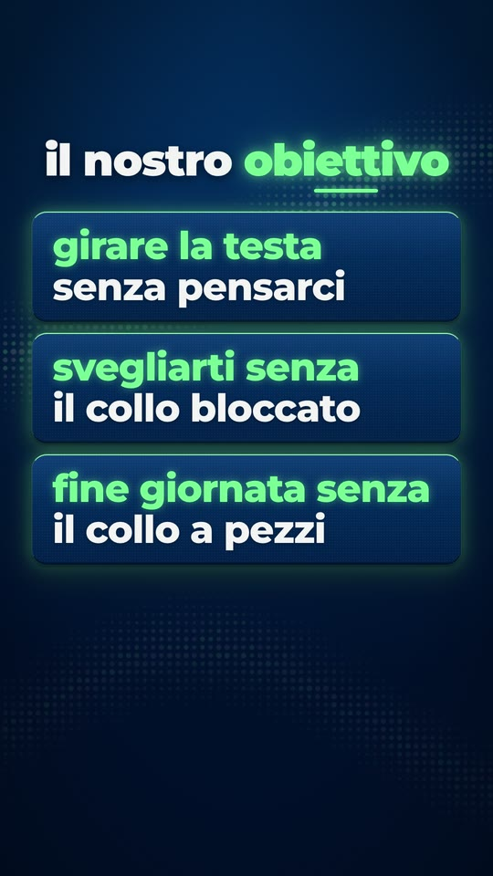

- **Cosa fa:** titolo sempre visibile e tre card blu notte con spessore una sotto l'altra, vuote e spente dal primo fotogramma; ognuna si accende con il suo testo di due righe sulla frase che la nomina, le precedenti sotto un velo blu, riepilogo; apparizioni a taglio, in mezzo il video base
- **Quando:** ads 9:16: tre frasi brevi non numerate (obiettivi, non garanzie), quando le card accese sono gia state usate subito prima
- **Quando no:** elenchi numerati (card-accese-9x16); piu di due righe per card; inquadrature con le 3D
- **Reference:** gadzhi-06
- **Ultimo voto:** 8 (AD_CERVICALGIA_AI-Barontini, direttore, giro 2, 04/11/2026; giro 1: 7)
- **Nel motore:** `{"modello": "card_spessore_ads", "usa": ["card_spessore", "card_accese"], "dati": {"apparizioni": "[{s, e}]", "titolo": "{testo, chiave, t, t_chiave, y, corpo}", "carte": "[{testo '*verde*|a capo', t, t_stato}]", "t_gusci": "s", "velo": 0.45, "guscio": 0.6, "t_riepilogo": "s"}}`
- **Origine:** laboratorio, fase 3 notte (04/11/2026), AD_CERVICALGIA_AI-Barontini
- **Variante di:** `card-con-spessore`
- **Nota:** approvata da Riccardo il 04/11/2026 (fase 3 ads, dopo l'anteprima completa). Modello nuovo in motore/inserti/scene/ (il modello di partenza resta com'e); riconosciuta da catalogo.identifica.

### Card vicino alle mani (`card-fluttuanti`, attivo)

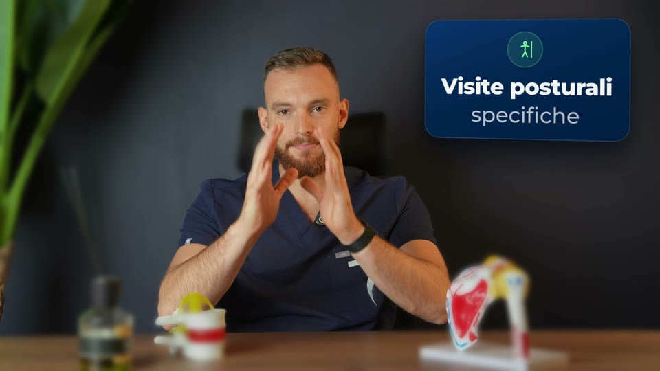

- **Cosa fa:** card che nascono sulla mano vera (Vision) e volano al loro posto
- **Quando:** due cose dette in fila
- **Quando no:** quando le mani sono al centro e le card dovrebbero coprirle
- **Reference:** gadzhi-06
- **Ultimo voto:** 8 (MR_POSTURA_01_v4, direttore, 02/11/2026)
- **Nel motore:** `{"modello": "card"}`
- **Origine:** campionario v1 e v2

### Card dietro la spalla (`card-dietro-la-spalla`, attivo)

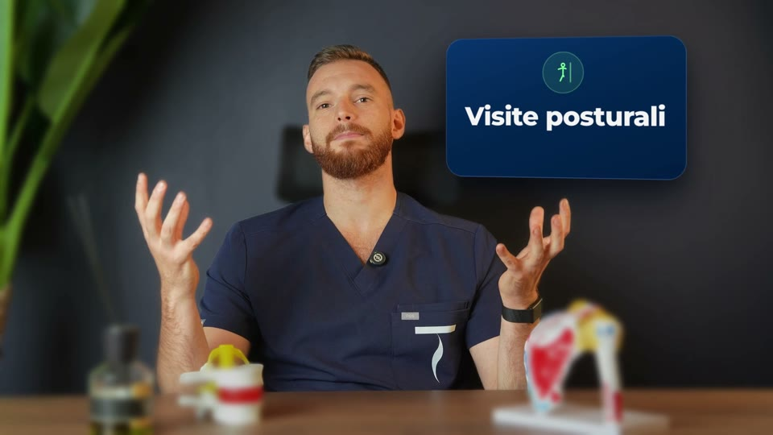

- **Cosa fa:** come le card vicino alle mani, ma la seconda passa dietro la spalla (profondità)
- **Quando:** come le card
- **Quando no:** —
- **Reference:** gadzhi-06
- **Ultimo voto:** 8 (MR_POSTURA_01_v4, direttore, 02/11/2026)
- **Nel motore:** `{"modello": "card", "dati": {"dietro": true}}`
- **Origine:** campionario v2, MR_POSTURA_01_v3

### Fumetti dei pensieri (`fumetti`, attivo)

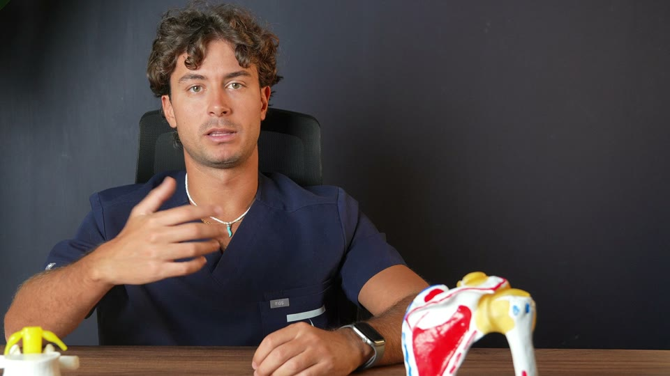

- **Cosa fa:** fumetti chiari con coda e luce interna, uno per frase, i precedenti salgono
- **Quando:** i pensieri che si dice da solo
- **Quando no:** frasi che non sono pensieri
- **Reference:** martell-05
- **Ultimo voto:** 7 (YT_POSTURA_32)
- **Nel motore:** `{"modello": "fumetti"}`
- **Origine:** YT_POSTURA_32

### Card accese a carrello (ads 9:16, tutto schermo) (`card-accese-9x16-carrello`, variante)

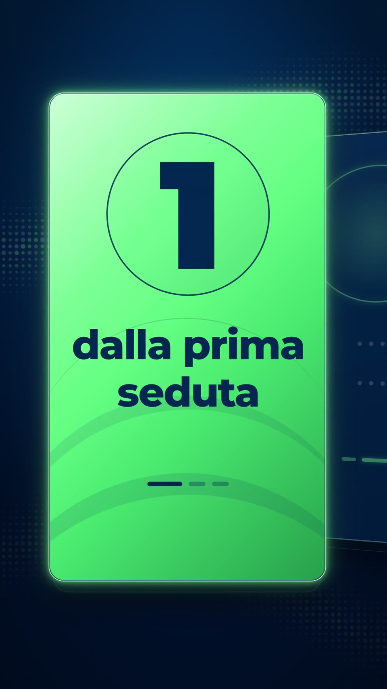

- **Cosa fa:** le card accese una per volta, grandi al centro, con la cifra detta piena sopra la frase chiave; carrello di camera da una card all'altra all'inizio di ogni apparizione; tutto schermo a taglio
- **Quando:** ads 9:16: tre motivi numerati, quando le card in colonna sono gia state usate in un altro ad
- **Quando no:** cifre non dette
- **Reference:** gadzhi-08, gadzhi-12, gadzhi-15
- **Ultimo voto:** 8 (AD_REFLUSSO, AD_BRUXISMO, AD_COLON, giro 2 dopo il rifacimento: card vicine visibili, «?» prima della cifra)
- **Nel motore:** `{"modello": "card_carrello_ads", "usa": ["card_accese", "card_accese_ads"], "dati": {}}`
- **Origine:** laboratorio, collaudo AD_REFLUSSO (04/11/2026): modello nuovo per gli ads, da un modello del catalogo
- **Variante di:** `card-accese-9x16`
- **Nota:** IN PROVA: modello nuovo per gli ads 9:16, costruito dopo l'ok di Riccardo al piano di AD_REFLUSSO (04/11/2026); diventa attivo solo con il suo ok. Modello motore/inserti/scene/card_carrello_ads.js (quello di partenza resta com'e).

### Etichette barrate centrate (ads 9:16, nella finestra) (`etichette-barrate-finestra-centrate`, variante)

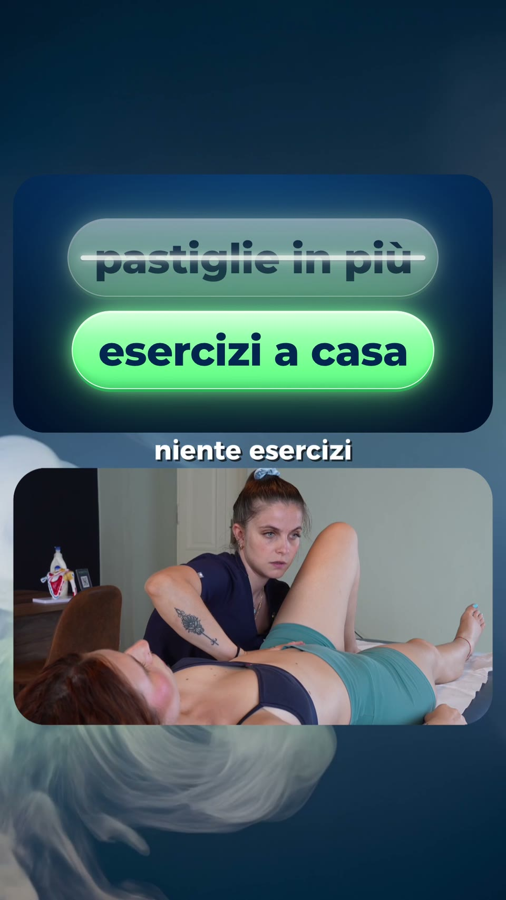

- **Cosa fa:** le pillole della v2 centrate nella finestra, entrate da lati opposti, la prima gia al primo fotogramma; barra panna dentro il contorno; fondo e pillole a taglio
- **Quando:** ads 9:16: due cose negate («niente pastiglie in più»), quando le pillole a sinistra sono gia state usate
- **Quando no:** inquadrature di schema C
- **Reference:** martell-01
- **Ultimo voto:** 7 (AD_REFLUSSO, AD_EMICRANIA, AD_BRUXISMO, AD_COLON)
- **Nel motore:** `{"modello": "etichette_centrate_ads", "usa": ["etichette_luce", "etichette_ads", "etichette_ads2"], "dati": {"modo": "finestra"}}`
- **Origine:** laboratorio, collaudo AD_REFLUSSO (04/11/2026): modello nuovo per gli ads, da un modello del catalogo
- **Variante di:** `etichette-barrate-finestra-v2`
- **Nota:** IN PROVA: modello nuovo per gli ads 9:16, costruito dopo l'ok di Riccardo al piano di AD_REFLUSSO (04/11/2026); diventa attivo solo con il suo ok. Modello motore/inserti/scene/etichette_centrate_ads.js (quello di partenza resta com'e).

### Riga di icone (ads 9:16, tutto schermo) (`riga-icone-9x16`, variante)

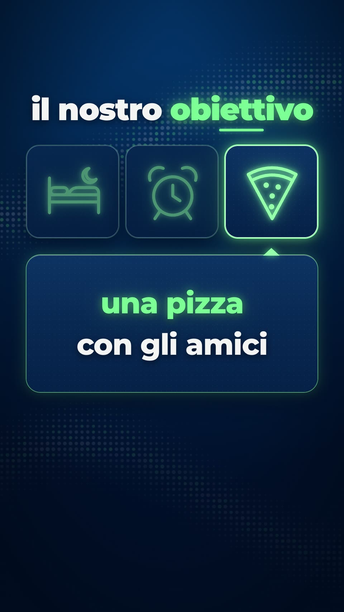

- **Cosa fa:** titolo in alto, tre riquadri con icone lineari verdi (oggetti, mai figure umane) che si disegnano e si accendono sulla loro frase, pannello grande con la frase dell'icona accesa; riempie lo schermo fino a y 1230
- **Quando:** ads 9:16: tre cose concrete dette (obiettivi: dormire, svegliarsi, una pizza)
- **Quando no:** cose astratte senza un oggetto; figure umane
- **Reference:** gadzhi-14, gadzhi-09
- **Ultimo voto:** 7 (AD_REFLUSSO, AD_EMICRANIA, AD_BRUXISMO giro 2: icone intere dal primo fotogramma, tessera accesa piena)
- **Nel motore:** `{"modello": "riga_icone_ads", "usa": [], "dati": {}}`
- **Origine:** laboratorio, collaudo AD_REFLUSSO (04/11/2026): modello nuovo per gli ads, da un modello del catalogo
- **Variante di:** `riga-icone`
- **Nota:** IN PROVA: modello nuovo per gli ads 9:16, costruito dopo l'ok di Riccardo al piano di AD_REFLUSSO (04/11/2026); diventa attivo solo con il suo ok. Modello motore/inserti/scene/riga_icone_ads.js (quello di partenza resta com'e).

## chiamata all'azione

### Lista d'attesa (`lista-attesa`, attivo)

- **Cosa fa:** righe che compaiono spente e si accendono sulla parola, in una finestra sul fondo del brand
- **Quando:** lista d'attesa, posti
- **Quando no:** —
- **Reference:** gadzhi-04
- **Ultimo voto:** 8 (MR_POSTURA_01_v4, direttore, 02/11/2026)
- **Nel motore:** `{"modello": "lista_attesa"}`
- **Origine:** campionario v1 e v2
- **Nota:** dal 01/11/2026 titolo nella forma del sito (forma: classica = variante)

### Lista d'attesa (classica) (`lista-attesa-classica`, variante)

- **Cosa fa:** la versione di MR_POSTURA_01_v3: titolo «Lista d'attesa» in Title Case, tutto panna
- **Quando:** —
- **Quando no:** —
- **Reference:** gadzhi-04
- **Ultimo voto:** 6 (campionario v2)
- **Nel motore:** `{"modello": "lista_attesa", "dati": {"forma": "classica"}}`
- **Origine:** campionario v1 e v2
- **Variante di:** `lista-attesa`
- **Nota:** variante dal 01/11/2026: il modello principale segue il brand del sito (minuscolo con il punto, chiave in gradiente)

### Link in descrizione (`cta-link`, attivo)

- **Cosa fa:** «Link in descrizione» grande con una freccia verde che cade e rimbalza
- **Quando:** quando lui rimanda alla descrizione
- **Quando no:** nei video senza link
- **Reference:** gadzhi-04
- **Ultimo voto:** 8 (MR_POSTURA_01_v4, direttore, 02/11/2026)
- **Nel motore:** `{"modello": "cta"}`
- **Origine:** campionario v1 e v2
- **Nota:** dal 01/11/2026 forma del sito: minuscolo con il punto, l'ultima parola in gradiente (forma: classica = variante)

### Link in descrizione (classica) (`cta-link-classica`, variante)

- **Cosa fa:** la versione di MR_POSTURA_01_v3: «Link in descrizione» in Title Case, tutto panna
- **Quando:** —
- **Quando no:** —
- **Reference:** gadzhi-04
- **Ultimo voto:** 6 (campionario v2)
- **Nel motore:** `{"modello": "cta", "dati": {"forma": "classica"}}`
- **Origine:** campionario v1 e v2
- **Variante di:** `cta-link`
- **Nota:** variante dal 01/11/2026: il modello principale segue il brand del sito (minuscolo con il punto, chiave in gradiente)

### Card e schermata di chiusura (`chiusura`, attivo)

- **Cosa fa:** card dietro la spalla, poi schermata piena con marchio, testo e freccia
- **Quando:** fine dei mid-roll
- **Quando no:** —
- **Reference:** martell-02
- **Ultimo voto:** 8 (MR_POSTURA_01_v4, direttore, 02/11/2026)
- **Nel motore:** `{"modello": "chiusura"}`
- **Origine:** MR_POSTURA_01_v3
- **Nota:** dal 01/11/2026 forma del sito e pittogramma su disco panna sopra il logo (forma: classica = variante)

### Chiusura con prezzo e modulo (ads 9:16, tutto schermo) (`chiusura-9x16`, attivo)

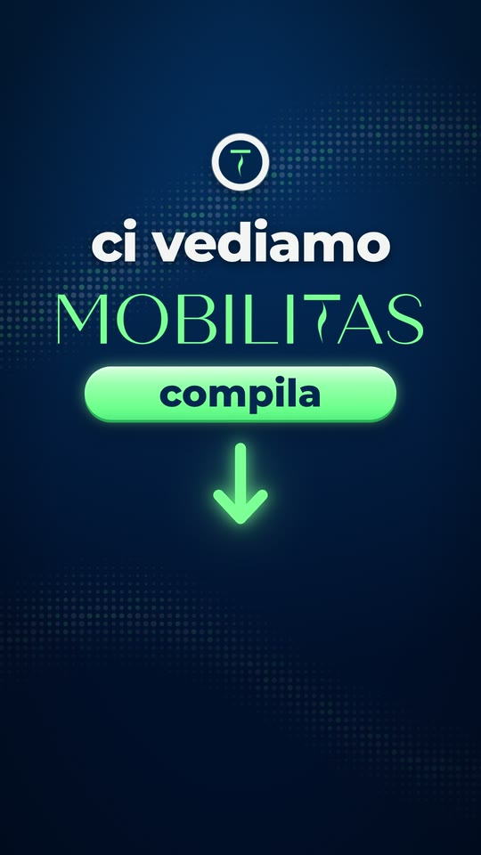

- **Cosa fa:** chiusura dell'ad a tutto schermo fino all'ultimo fotogramma: lista che si accende sulle parole (da lista-attesa), prezzo detto grande, modulo stilizzato con campi vuoti che si evidenziano (da inserto-modulo, senza etichette ne dati), marchio con pittogramma e logo, pulsante che resta e freccia verso il pulsante dell'ad (da chiusura)
- **Quando:** ads 9:16: la chiamata all'azione finale con prezzo e modulo detti dalla voce
- **Quando no:** prezzi barrati o confronti, numeri di posti non detti, campi con etichette
- **Reference:** gadzhi-04, martell-02
- **Ultimo voto:** 9 (AD_CERVICALGIA_AI-Barontini, direttore, giro 2, 04/11/2026; giro 1: 8)
- **Nel motore:** `{"modello": "chiusura_ads", "usa": ["card_accese"], "dati": {"lista": "…", "prezzo": "…", "modulo": "…", "marchio": "…"}}`
- **Origine:** laboratorio, fase 3 notte (04/11/2026), AD_CERVICALGIA_AI-Barontini
- **Variante di:** `chiusura`
- **Nota:** approvata da Riccardo il 04/11/2026 (fase 3 ads, dopo l'anteprima completa). Modello nuovo in motore/inserti/scene/ (il modello di partenza resta com'e); riconosciuta da catalogo.identifica.

### Chiusura con prezzo e modulo (ads 9:16, tutto schermo), variante 2 (`chiusura-9x16-v2`, variante)

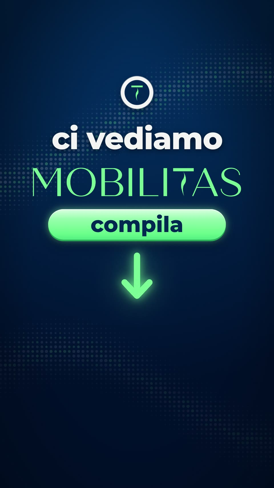

- **Cosa fa:** chiusura dell'ad a tutto schermo fino all'ultimo fotogramma: lista che si accende sulle parole (da lista-attesa), prezzo detto grande, modulo stilizzato con campi vuoti che si evidenziano (da inserto-modulo, senza etichette ne dati), marchio con pittogramma e logo, pulsante che resta e freccia verso il pulsante dell'ad (da chiusura) Variante 2: «ci vediamo» entra intero, senza maschera (niente segni staccati sopra «compila»). Giro 3: anche le righe della lista e «a soli» entrano intere, senza maschera.
- **Quando:** ads 9:16: la chiamata all'azione finale con prezzo e modulo detti dalla voce
- **Quando no:** prezzi barrati o confronti, numeri di posti non detti, campi con etichette
- **Reference:** gadzhi-04, martell-02
- **Ultimo voto:** 7 (AD_CERVICALGIA, direttore cieco, giro 3, 04/11/2026; giri 1 e 2: 7): nessun testo tagliato da una maschera
- **Nel motore:** `{"modello": "chiusura_ads2", "usa": ["card_accese", "chiusura_ads"], "dati": {"lista": "…", "prezzo": "…", "modulo": "…", "marchio": "…"}}`
- **Origine:** laboratorio, fase 5 (04/11/2026): correzione di un difetto trovato dal direttore nella fase 4
- **Variante di:** `chiusura-9x16`
- **Nota:** IN PROVA: diventa attiva solo con l'ok di Riccardo; fino ad allora i piani dei nuovi ads la usano al posto di «chiusura-9x16», segnata «in prova». Correzione: «ci vediamo» entra intero, senza maschera (niente segni staccati sopra «compila»). Modello motore/inserti/scene/chiusura_ads2.js (copia di quello di partenza, che resta com'e). Giro 3: anche le righe della lista e «a soli» entrano intere, senza maschera.

### Chiusura (classica) (`chiusura-classica`, variante)

- **Cosa fa:** la versione di MR_POSTURA_01_v3: logo e «Link in descrizione» senza pittogramma
- **Quando:** —
- **Quando no:** —
- **Reference:** martell-02
- **Ultimo voto:** parte del voto 8 di MR_POSTURA_01_v3
- **Nel motore:** `{"modello": "chiusura", "dati": {"forma": "classica"}}`
- **Origine:** MR_POSTURA_01_v3
- **Variante di:** `chiusura`
- **Nota:** variante dal 01/11/2026: il modello principale segue il brand del sito (minuscolo con il punto, chiave in gradiente)

### Schermata finale YouTube (`schermata-finale-youtube`, attivo)

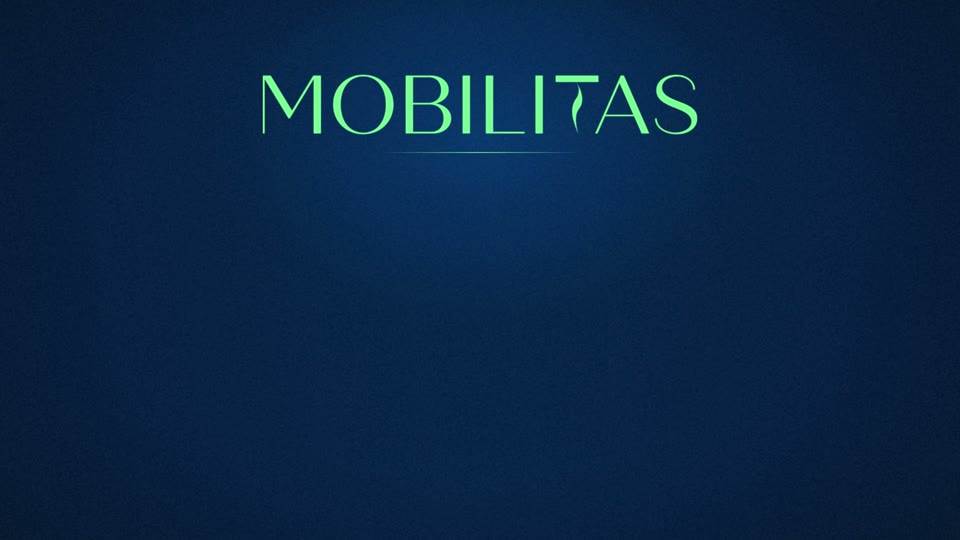

- **Cosa fa:** 12 s dopo l'ultima parola: fondo del brand, logo, pittogramma su disco panna, zone libere per gli elementi di YouTube
- **Quando:** fine dei video YouTube
- **Quando no:** mid-roll
- **Reference:** —
- **Ultimo voto:** — (approvata con il video YT_POSTURA_32)
- **Nel motore:** `{"regia": ["scena.coda"]}`
- **Origine:** YT_POSTURA_32 tappa 3

## oggetti veri

### Telefono in prospettiva (app vera) (`telefono-prospettiva`, attivo)

- **Cosa fa:** telefono in prospettiva con le schermate vere dell'app, messa a fuoco e colpo di camera
- **Quando:** quando lui parla dell'app
- **Quando no:** schermate con dati di persone, importi o frasi sulla salute non sfocati; telefono grande che copre lui
- **Reference:** martell-06
- **Ultimo voto:** 7 (MR_POSTURA_01_v4, direttore, 02/11/2026) — dopo il quinto giro il profilo l'ho verificato io
- **Nel motore:** `{"modello": "telefono3d"}`
- **Origine:** campionario v1 e v2
- **Nota:** render dell'app scontornati dal motore (titolo: false, tieni_bianco: true per i render senza titolo e con card bianche). fase 7c: entrata = 'posto' -> nasce dove sta (niente viaggio da fuori quadro, che non passa il controllo del quadro: anche in MR_POSTURA_01_v3), cambio di schermata sul posto, alone verde tenue dietro; piu schermate cambiano sul posto, ognuna sulle sue parole; `sfoca`: [[x0, y0, x1, y1], ...] (px del file) sfoca le righe con dati di persone, importi o frasi sulla salute (Riccardo, 02/11/2026: tutte le foto dell'app, in modo estetico e minimale)

### Telefono con la sagoma (`telefono-sagoma`, vietato)

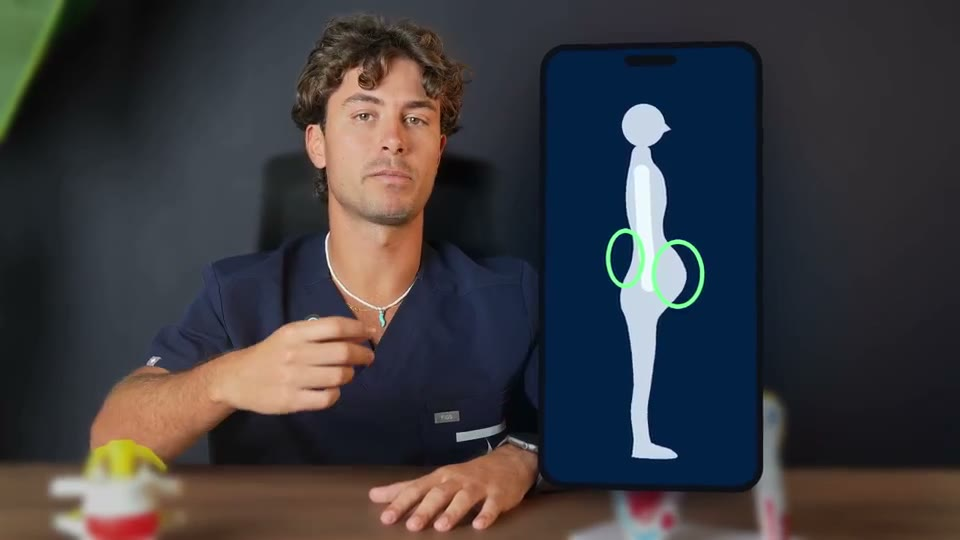

- **Cosa fa:** telefono con una «foto» fatta dalla sagoma disegnata
- **Quando:** mai
- **Quando no:** mai: bocciato da Riccardo
- **Reference:** —
- **Ultimo voto:** bocciato
- **Nel motore:** `{"modello": "telefono3d", "dati": {"genera": "foto_sagoma"}}`
- **Origine:** YT_POSTURA_32 tappa 1

### Foto vera in card (`foto-card`, attivo)

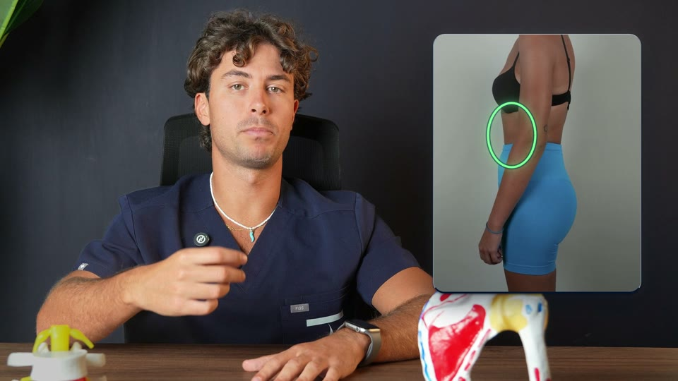

- **Cosa fa:** foto vera di un paziente (consenso nel catalogo), viso tagliato fuori, in card; solo PRIMA e DOPO come testo
- **Quando:** quando lui parla di come si vede di lato
- **Quando no:** senza consenso; con tempi o risultati scritti
- **Reference:** martell-06
- **Ultimo voto:** 6 (YT_POSTURA_32)
- **Nel motore:** `{"modello": "foto_card"}`
- **Origine:** YT_POSTURA_32

### Prima/dopo con cursore (`prima-dopo-cursore`, attivo)

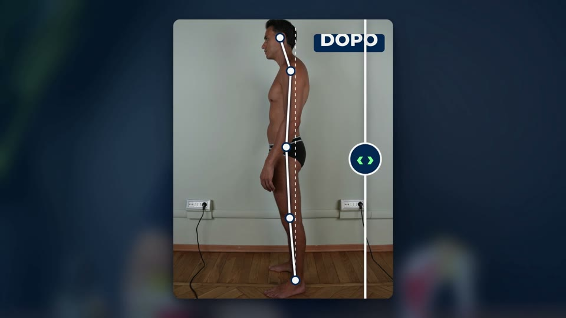

- **Cosa fa:** due foto del paziente (data EXIF), PRIMA a sinistra e DOPO a destra, linea posturale di Vision, cursore
- **Quando:** quando lui parla dei risultati dello studio, senza promesse
- **Quando no:** senza consenso; foto quasi uguali
- **Reference:** gadzhi-05
- **Ultimo voto:** 7 (MR_POSTURA_01_v4, direttore, 02/11/2026)
- **Nel motore:** `{"modello": "confronto"}`
- **Origine:** campionario v1 e v2
- **Nota:** fase 7c: cursore.modo = 'meta' -> fermo a meta dall'entrata (PRIMA e DOPO sempre leggibili), poi una sola corsa fino a `fino`

## anatomia

### Anatomia Servier in card (`anatomia-card`, attivo)

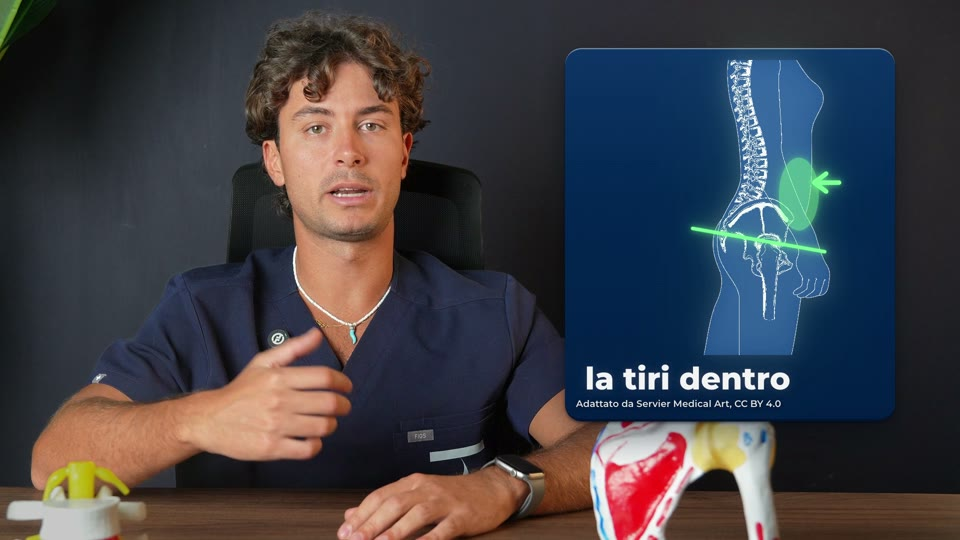

- **Cosa fa:** disegno Servier ricolorato in una card accanto a lui, aloni, frecce, assi, etichette sulla voce, attribuzione
- **Quando:** un meccanismo detto, accanto a lui
- **Quando no:** aggiunte cliniche non dette
- **Reference:** martell-06, gadzhi-06
- **Ultimo voto:** 7 (YT_POSTURA_32)
- **Nel motore:** `{"modello": "anatomia", "dati": {"pannello": "card"}}`
- **Origine:** YT_POSTURA_32

### Anatomia Servier in scena scura (`anatomia-scena`, attivo)

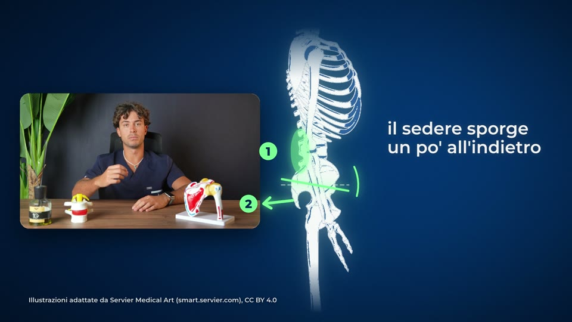

- **Cosa fa:** disegno Servier a tutto schermo su fondo scuro, camera che si muove fra le parti, lui in finestra o in cerchio
- **Quando:** il meccanismo centrale del video
- **Quando no:** più di 2-3 volte per video
- **Reference:** martell-07
- **Ultimo voto:** 7 (YT_POSTURA_32)
- **Nel motore:** `{"modello": "anatomia", "dati": {"pannello": "pieno"}}`
- **Origine:** YT_POSTURA_32

### Scena anatomica (ads 9:16, tutto schermo) (`anatomia-scena-9x16`, variante)

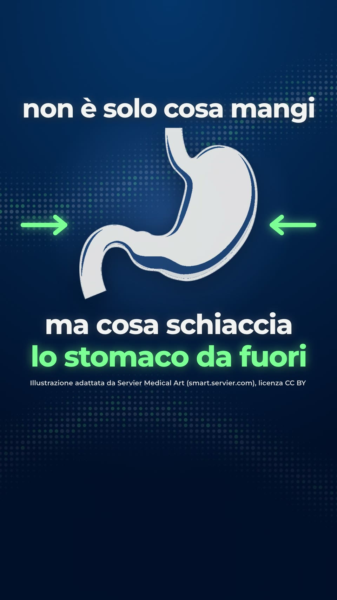

- **Cosa fa:** fondo del sito con retino, un disegno Servier ricolorato nel brand fermo al centro (mai deformato), frecce verdi generiche sulla parola, righe dette sopra e sotto, attribuzione Servier in basso (senza cifre)
- **Quando:** ads 9:16: un meccanismo detto che si capisce meglio visto, su un'inquadratura senza 3D
- **Quando no:** inquadrature con animazioni 3D; etichette anatomiche non dette; disegni non in libreria/anatomia
- **Reference:** martell-07
- **Ultimo voto:** 7 (AD_REFLUSSO)
- **Nel motore:** `{"modello": "anatomia_ads", "usa": [], "dati": {"servier": {"nome": "servier_smart-stomach.png", "alto": 540, "modo": "ossa"}}}`
- **Origine:** laboratorio, collaudo AD_REFLUSSO (04/11/2026): modello nuovo per gli ads, da un modello del catalogo
- **Variante di:** `anatomia-scena`
- **Nota:** IN PROVA: modello nuovo per gli ads 9:16, costruito dopo l'ok di Riccardo al piano di AD_REFLUSSO (04/11/2026); diventa attivo solo con il suo ok. Modello motore/inserti/scene/anatomia_ads.js (quello di partenza resta com'e).

## vietati

### Sagoma vettoriale (`sagoma-vettoriale`, vietato)

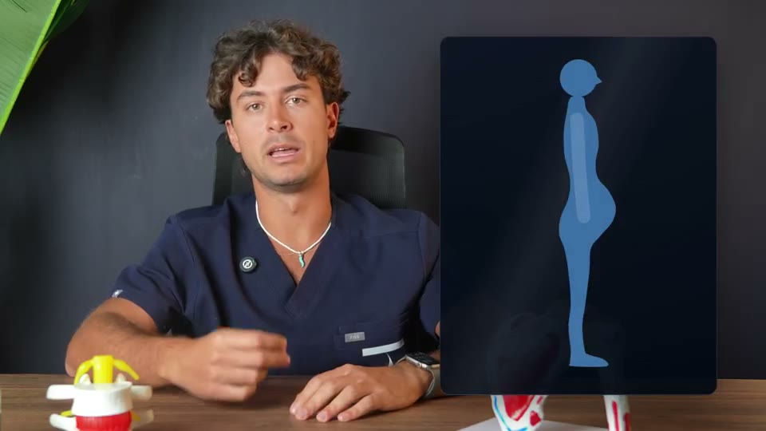

- **Cosa fa:** figura umana disegnata da noi (profilo posturale)
- **Quando:** mai
- **Quando no:** mai: bocciata da Riccardo (niente figure umane disegnate)
- **Reference:** —
- **Ultimo voto:** bocciata
- **Nel motore:** `{"modello": "sagoma"}`
- **Origine:** YT_POSTURA_32 tappa 1 e inserti di MR_POSTURA_01_v2

### Sagoma a pannello (prima generazione) (`inserto-sagoma`, vietato)

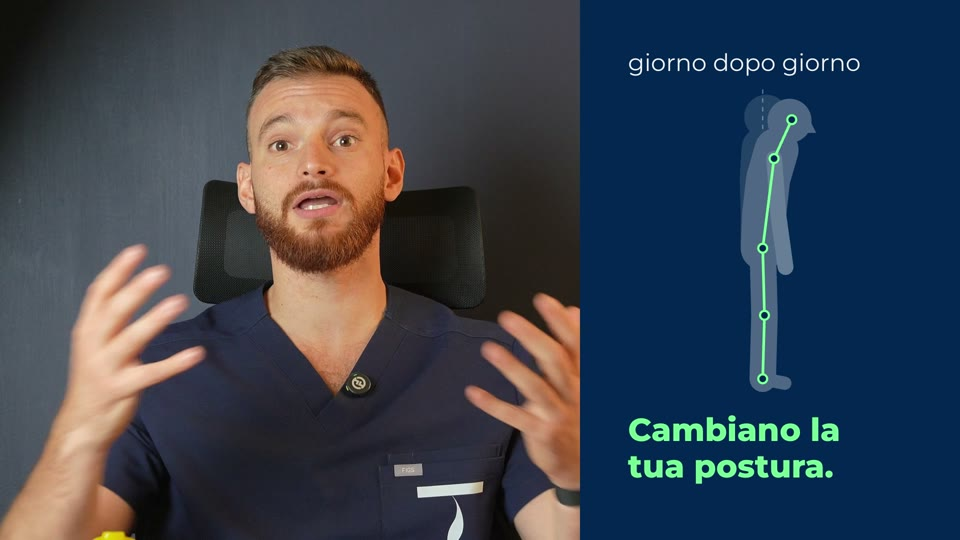

- **Cosa fa:** profilo posturale disegnato su pannello
- **Quando:** mai
- **Quando no:** mai: bocciata da Riccardo
- **Reference:** —
- **Ultimo voto:** bocciata
- **Nel motore:** `{"inserto": "sagoma"}`
- **Origine:** MR_POSTURA_01_v2

## prima generazione

### Aggancio a pannello (prima generazione) (`inserto-aggancio`, variante)

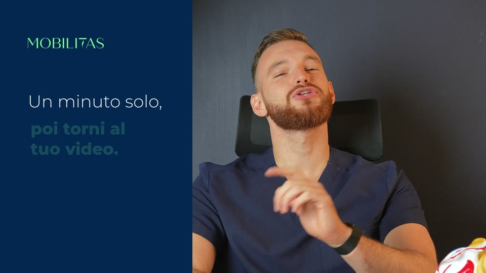

- **Cosa fa:** frase d'apertura su un pannello accanto alla persona, con il logo
- **Quando:** —
- **Quando no:** —
- **Reference:** —
- **Ultimo voto:** — (MR_POSTURA_01_v2)
- **Nel motore:** `{"inserto": "aggancio"}`
- **Origine:** MR_POSTURA_01_v2
- **Variante di:** `frase-sul-corpo`

### Numero a pannello (prima generazione) (`inserto-numero`, variante)

- **Cosa fa:** numero che conta su un pannello accanto alla persona
- **Quando:** —
- **Quando no:** —
- **Reference:** —
- **Ultimo voto:** — (MR_POSTURA_01_v2)
- **Nel motore:** `{"inserto": "numero"}`
- **Origine:** MR_POSTURA_01_v2
- **Variante di:** `numero-dietro`

### Prodotto a pannello (prima generazione) (`inserto-prodotto`, variante)

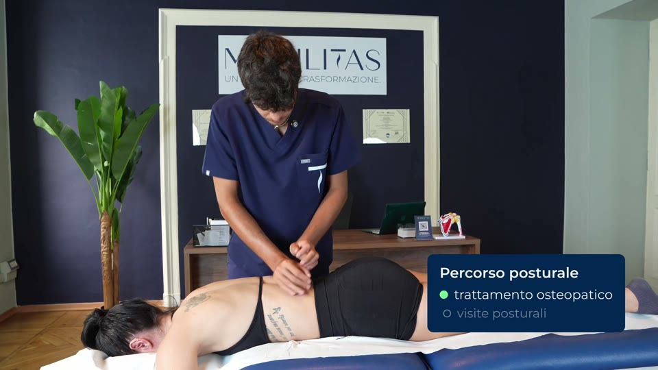

- **Cosa fa:** voci del servizio su un pannello
- **Quando:** —
- **Quando no:** —
- **Reference:** —
- **Ultimo voto:** — (MR_POSTURA_01_v2)
- **Nel motore:** `{"inserto": "prodotto"}`
- **Origine:** MR_POSTURA_01_v2
- **Variante di:** `card-fluttuanti`

### Telefono a pannello (prima generazione) (`inserto-telefono`, variante)

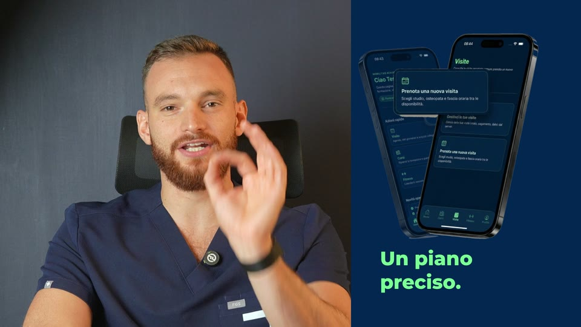

- **Cosa fa:** schermate dell'app in un telefono piatto sul pannello
- **Quando:** —
- **Quando no:** —
- **Reference:** —
- **Ultimo voto:** — (MR_POSTURA_01_v2)
- **Nel motore:** `{"inserto": "telefono"}`
- **Origine:** MR_POSTURA_01_v2
- **Variante di:** `telefono-prospettiva`

### Prima/dopo a pannello (prima generazione) (`inserto-primadopo`, variante)

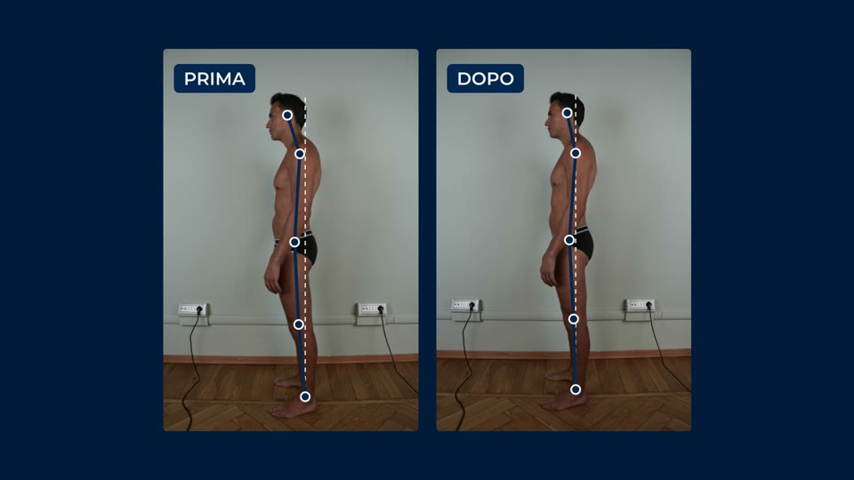

- **Cosa fa:** due foto affiancate con la linea posturale su blu profondo
- **Quando:** —
- **Quando no:** —
- **Reference:** —
- **Ultimo voto:** — (MR_POSTURA_01_v2)
- **Nel motore:** `{"inserto": "primadopo"}`
- **Origine:** MR_POSTURA_01_v2
- **Variante di:** `prima-dopo-cursore`

### Lista a pannello (prima generazione) (`inserto-lista`, variante)

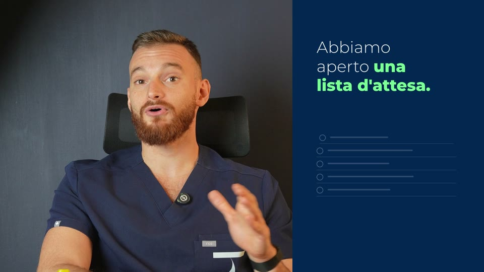

- **Cosa fa:** lista d'attesa in più tempi su un pannello
- **Quando:** —
- **Quando no:** —
- **Reference:** —
- **Ultimo voto:** — (MR_POSTURA_01_v2)
- **Nel motore:** `{"inserto": "lista"}`
- **Origine:** MR_POSTURA_01_v2
- **Variante di:** `lista-attesa`

### Scelte a pannello (prima generazione) (`inserto-scelte`, variante)

- **Cosa fa:** due o tre scelte su un pannello
- **Quando:** —
- **Quando no:** —
- **Reference:** —
- **Ultimo voto:** — (MR_POSTURA_01_v2)
- **Nel motore:** `{"inserto": "scelte"}`
- **Origine:** MR_POSTURA_01_v2
- **Variante di:** `card-fluttuanti`

### Modulo stilizzato (prima generazione) (`inserto-modulo`, variante)

- **Cosa fa:** campi vuoti che si evidenziano quando li nomina
- **Quando:** —
- **Quando no:** —
- **Reference:** —
- **Ultimo voto:** — (MR_POSTURA_01_v2)
- **Nel motore:** `{"inserto": "modulo"}`
- **Origine:** MR_POSTURA_01_v2
- **Variante di:** `cta-link`

### Chiusura a pannello (prima generazione) (`inserto-chiusura`, variante)

- **Cosa fa:** pannello che si allarga a tutto schermo dopo l'ultima parola
- **Quando:** —
- **Quando no:** —
- **Reference:** —
- **Ultimo voto:** — (MR_POSTURA_01_v2)
- **Nel motore:** `{"inserto": "chiusura"}`
- **Origine:** MR_POSTURA_01_v2
- **Variante di:** `chiusura`

### Look caldo (`look-caldo`, variante)

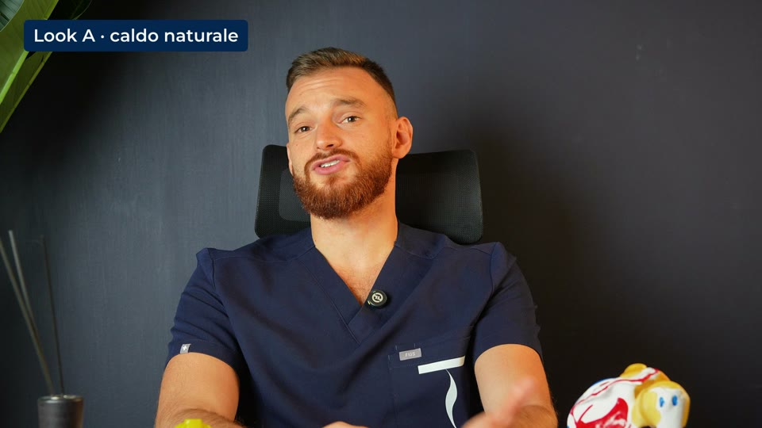

- **Cosa fa:** correzione colore calda sul girato
- **Quando:** —
- **Quando no:** Riccardo: look originale, nessuna correzione del girato
- **Reference:** —
- **Ultimo voto:** — (campionario v1)
- **Nel motore:** `{"piatto": ["look_caldo"]}`
- **Origine:** campionario v1

### Look profondo (`look-profondo`, variante)

- **Cosa fa:** correzione colore profonda sul girato
- **Quando:** —
- **Quando no:** Riccardo: look originale, nessuna correzione del girato
- **Reference:** —
- **Ultimo voto:** — (campionario v1)
- **Nel motore:** `{"piatto": ["look_profondo"]}`
- **Origine:** campionario v1

## micro-grafiche (reel)

### Micro: parola chiave in pillola (`micro-parola`, variante)

- **Cosa fa:** una parola o due dette, in una pillola di vetro blu (o verde con il testo blu notte) che si allunga da sinistra mentre la parola si mette a fuoco; icona tonda a sinistra a scelta; evidenziatore a scelta
- **Quando:** reel a densità piena: la parola che conta di una frase detta, fra due grafiche grandi
- **Quando no:** frasi lunghe (più di ~18 lettere a corpo 88); sopra volti, mani, sottotitoli
- **Condizioni (controllate dal motore):** dentro dati.box, box nella zona sicura e nelle zone libere della radiografia (niente volti, mani, sottotitoli, scritte), mai insieme a un'altra grafica, niente effetto sonoro
- **Reference:** gadzhi-17, gadzhi-19
- **Ultimo voto:** —
- **Nel motore:** `{"modello": "micro_reel", "usa": ["riga_icone_ads"], "dati": {"modo": "micro", "tipo": "parola"}}`
- **Origine:** laboratorio reel-grafiche, fase 6 (05/11/2026): densità «piena», livello delle micro-grafiche
- **Nota:** IN PROVA (fase 6, 05/11/2026): modello nuovo dell'agente reel-grafiche; diventa attivo solo con l'ok di Riccardo, anche dopo l'uscita dal laboratorio. Modello motore/inserti/scene/micro_reel.js.

### Micro: scheda con icona (grande) (`micro-scheda`, variante)

- **Cosa fa:** card di vetro grande nella finestra: disco con un'icona lineare che si disegna a sinistra e, a destra, una o due righe dette che compaiono ognuna sulla sua parola (la seconda in verde)
- **Quando:** reel a densità piena, nella finestra grande quando non c'è un'infografica grande: un concetto detto con un oggetto che lo regge («professionista specializzato» → stella, «trattamento di un'ora» → orologio)
- **Quando no:** righe lunghe (più di ~20 lettere a corpo 110); icone senza legame con le parole; sopra volti o mani
- **Condizioni (controllate dal motore):** dentro dati.box, box nella zona sicura e nelle zone libere della radiografia (niente volti, mani, sottotitoli, scritte), grande: testo con corpo almeno 110 e riquadro di almeno il 15% della finestra (niente badge negli angoli), testo nella finestra grande o lontano almeno 150 px dalla fascia dei sottotitoli, mai insieme a un'altra grafica, niente effetto sonoro
- **Reference:** gadzhi-19, gadzhi-14
- **Ultimo voto:** —
- **Nel motore:** `{"modello": "micro_reel", "usa": ["riga_icone_ads"], "dati": {"modo": "micro", "tipo": "scheda"}}`
- **Origine:** laboratorio reel-grafiche, fase 6, giro 3 (05/11/2026): «micro-grafiche grandi e visibili; la finestra grande è la tela principale» (Riccardo)
- **Nota:** IN PROVA (fase 6, giro 3, 05/11/2026): diventa attivo solo con l'ok di Riccardo. Modello motore/inserti/scene/micro_reel.js.

### Micro: parole chiave grandi sulla voce (`micro-parole`, variante)

- **Cosa fa:** una, due o tre parole chiave dette, grandi, ognuna in un pannello di vetro (o verde) impilato al centro della finestra; ognuna entra sulla sua parola detta con un piccolo colpo di scala; sottolineatura verde a scelta
- **Quando:** reel a densità piena, nella finestra grande: le parole che contano di una frase («nemmeno… in bianco», «dolci, profonde, precise»), quando non c'è un'infografica grande
- **Quando no:** frasi intere (non è un secondo sottotitolo: solo le parole chiave); vicino ai sottotitoli fuori dalla finestra; sopra volti o mani
- **Condizioni (controllate dal motore):** dentro dati.box, box nella zona sicura e nelle zone libere della radiografia (niente volti, mani, sottotitoli, scritte), grande: testo con corpo almeno 110 e riquadro di almeno il 15% della finestra (niente badge negli angoli), testo nella finestra grande o lontano almeno 150 px dalla fascia dei sottotitoli, mai insieme a un'altra grafica, niente effetto sonoro
- **Reference:** gadzhi-17, gadzhi-19
- **Ultimo voto:** —
- **Nel motore:** `{"modello": "micro_reel", "usa": ["riga_icone_ads"], "dati": {"modo": "micro", "tipo": "parole"}}`
- **Origine:** laboratorio reel-grafiche, fase 6, giro 3 (05/11/2026): «parole sì anche con i sottotitoli impressi, purché GRANDI, nella finestra e sincronizzate con la voce» (Riccardo)
- **Nota:** IN PROVA (fase 6, giro 3, 05/11/2026): diventa attivo solo con l'ok di Riccardo. Modello motore/inserti/scene/micro_reel.js.

### Micro: icona che si disegna (`micro-icona`, variante)

- **Cosa fa:** un'icona lineare verde (oggetti, mai figure umane) che si disegna con il tratto in un disco di vetro, con la parola detta sotto a scelta
- **Quando:** un oggetto detto («in bianco» → piatto, «bruciore» → fiamma)
- **Quando no:** cose astratte senza un oggetto
- **Condizioni (controllate dal motore):** dentro dati.box, box nella zona sicura e nelle zone libere della radiografia (niente volti, mani, sottotitoli, scritte), mai insieme a un'altra grafica, niente effetto sonoro
- **Reference:** gadzhi-14, gadzhi-19
- **Ultimo voto:** —
- **Nel motore:** `{"modello": "micro_reel", "usa": ["riga_icone_ads"], "dati": {"modo": "micro", "tipo": "icona"}}`
- **Origine:** laboratorio reel-grafiche, fase 6 (05/11/2026): densità «piena», livello delle micro-grafiche
- **Nota:** IN PROVA (fase 6, 05/11/2026): modello nuovo dell'agente reel-grafiche; diventa attivo solo con l'ok di Riccardo, anche dopo l'uscita dal laboratorio. Modello motore/inserti/scene/micro_reel.js.

### Micro: numero detto (`micro-numero`, variante)

- **Cosa fa:** la cifra detta, grande e verde con il bagliore, già giusta dal primo fotogramma, con la parola detta sotto a scelta
- **Quando:** un numero detto («il terzo», «3 motivi»)
- **Quando no:** numeri non detti (mai)
- **Condizioni (controllate dal motore):** dentro dati.box, box nella zona sicura e nelle zone libere della radiografia (niente volti, mani, sottotitoli, scritte), mai insieme a un'altra grafica, niente effetto sonoro
- **Reference:** gadzhi-18, gadzhi-03
- **Ultimo voto:** —
- **Nel motore:** `{"modello": "micro_reel", "usa": ["riga_icone_ads"], "dati": {"modo": "micro", "tipo": "numero"}}`
- **Origine:** laboratorio reel-grafiche, fase 6 (05/11/2026): densità «piena», livello delle micro-grafiche
- **Nota:** IN PROVA (fase 6, 05/11/2026): modello nuovo dell'agente reel-grafiche; diventa attivo solo con l'ok di Riccardo, anche dopo l'uscita dal laboratorio. Modello motore/inserti/scene/micro_reel.js.

### Micro: freccia che si disegna (`micro-freccia`, variante)

- **Cosa fa:** una freccia verde con il bagliore che si disegna in 6 fotogrammi verso un dettaglio del B-roll
- **Quando:** la voce nomina una cosa che si vede nel B-roll
- **Quando no:** dettagli che si muovono molto; volti
- **Condizioni (controllate dal motore):** dentro dati.box, box nella zona sicura e nelle zone libere della radiografia (niente volti, mani, sottotitoli, scritte), mai insieme a un'altra grafica, niente effetto sonoro
- **Reference:** gadzhi-13
- **Ultimo voto:** —
- **Nel motore:** `{"modello": "micro_reel", "usa": ["riga_icone_ads"], "dati": {"modo": "micro", "tipo": "freccia"}}`
- **Origine:** laboratorio reel-grafiche, fase 6 (05/11/2026): densità «piena», livello delle micro-grafiche
- **Nota:** IN PROVA (fase 6, 05/11/2026): modello nuovo dell'agente reel-grafiche; diventa attivo solo con l'ok di Riccardo, anche dopo l'uscita dal laboratorio. Modello motore/inserti/scene/micro_reel.js.

### Micro: cerchio su un dettaglio (`micro-cerchio`, variante)

- **Cosa fa:** un anello verde tracciato come a mano attorno a un dettaglio del B-roll, con la parola detta sopra o sotto a scelta
- **Quando:** la voce nomina una cosa che si vede nel B-roll (le mani che lavorano)
- **Quando no:** volti; dettagli che escono dall'inquadratura
- **Condizioni (controllate dal motore):** dentro dati.box, box nella zona sicura e nelle zone libere della radiografia (niente volti, mani, sottotitoli, scritte), mai insieme a un'altra grafica, niente effetto sonoro
- **Reference:** gadzhi-05, gadzhi-17
- **Ultimo voto:** —
- **Nel motore:** `{"modello": "micro_reel", "usa": ["riga_icone_ads"], "dati": {"modo": "micro", "tipo": "cerchio"}}`
- **Origine:** laboratorio reel-grafiche, fase 6 (05/11/2026): densità «piena», livello delle micro-grafiche
- **Nota:** IN PROVA (fase 6, 05/11/2026): modello nuovo dell'agente reel-grafiche; diventa attivo solo con l'ok di Riccardo, anche dopo l'uscita dal laboratorio. Modello motore/inserti/scene/micro_reel.js.

## camera (reel)

### Zoom e spinte di camera leggeri sul video base (`zoom-leggero-9x16`, variante)

- **Cosa fa:** ingrandimento morbido del video base (tutto il quadro o solo il contenuto di una finestra), al massimo 8-10%, «spinta» fino al taglio o «respiro» che torna a 1; colori intatti (ricampionamento dei piani YUV), fotogrammi fuori dallo zoom identici bit per bit
- **Quando:** una pausa lunga senza grafiche, su un'inquadratura ferma
- **Quando no:** sotto una grafica a finestra, a tutto schermo o sulla persona; se taglia sottotitoli, scritte o la testa (controllo automatico); finestre con i sottotitoli dentro (schema C)
- **Condizioni (controllate dal motore):** scala ≤ 1,10, almeno 1,5 s, ≤ 5% al secondo, dentro un'inquadratura, niente tagli di sottotitoli, scritte, teste
- **Reference:** gadzhi-04, gadzhi-12, gadzhi-23
- **Ultimo voto:** —
- **Nel motore:** `{"modello": null, "usa": [], "dati": {"piano": "zoom"}}`
- **Origine:** laboratorio reel-grafiche, fase 6 (05/11/2026): densità «piena», zoom leggeri
- **Variante di:** `camera-viva`
- **Nota:** IN PROVA (fase 6, 05/11/2026): modello nuovo dell'agente reel-grafiche; diventa attivo solo con l'ok di Riccardo, anche dopo l'uscita dal laboratorio. Motore: motore/motore/reel_zoom.py.

## suono (reel)

### Effetti sonori sotto le grafiche importanti (`effetti-sonori-reel`, attivo)

- **Cosa fa:** un effetto della libreria libreria/sfx (Pixabay) sull'entrata di una grafica importante, ben sotto la voce (di solito 20-24 dB sotto il parlato); la versione senza effetti esce sempre accanto, con l'audio copiato
- **Quando:** entrate delle infografiche grandi
- **Quando no:** micro-grafiche; più di un effetto per grafica
- **Condizioni (controllate dal motore):** al massimo -12 dB dalla voce, prova: tolti gli effetti, l'audio è l'originale (residuo al livello della sola ricodifica)
- **Reference:** —
- **Ultimo voto:** —
- **Nel motore:** `{"modello": null, "usa": [], "dati": {"piano": "grafiche[].suono"}}`
- **Origine:** laboratorio reel-grafiche, fase 6 (05/11/2026): densità «piena», effetti sonori
- **Nota:** approvato da Riccardo il 09/11/2026 (ok all'anteprima di REEL_MOFU_CERVICALGIA_TEST: 3 effetti a −24 dB, whoosh e pop). Motore: motore/motore/reel_suono.py.

## sulla persona (reel)

### Titolo dietro di lui (reel 9:16) (`titolo-dietro-9x16`, variante)

- **Cosa fa:** una o due righe di parole dette, enormi (Montserrat Black), che salgono da dietro le spalle e restano dietro la testa: il motore rimette sopra la persona con la sagoma di Apple Vision
- **Quando:** il tema di un capitolo detto, con la persona in camera e spazio sopra la testa
- **Quando no:** persona che si muove molto o esce dal quadro; titoli che la testa coprirebbe per più di un quarto
- **Condizioni (controllate dal motore):** inquadratura «persona in camera», la persona copre al massimo il 25% della grafica (controllo del render), niente sottotitoli o scritte coperti
- **Reference:** martell-02
- **Ultimo voto:** —
- **Nel motore:** `{"modello": "persona_reel", "usa": [], "dati": {"modo": "persona", "tipo": "titolo", "dietro": true}}`
- **Origine:** laboratorio reel-grafiche, fase 6 (05/11/2026): modelli sulla persona in camera (ad con frontman, reel MOFU)
- **Variante di:** `titolo-dietro`
- **Nota:** IN PROVA (fase 6, 05/11/2026): adattamento al 9:16 del modello YouTube (che resta com'è); diventa attivo solo con l'ok di Riccardo, anche dopo l'uscita dal laboratorio. Modello motore/inserti/scene/persona_reel.js.

### Numero gigante dietro di lui (reel 9:16) (`numero-dietro-9x16`, variante)

- **Cosa fa:** la cifra detta, gigante, a contorno verde con il bagliore, dietro la persona
- **Quando:** un numero detto («3 motivi»)
- **Quando no:** numeri non detti (mai)
- **Condizioni (controllate dal motore):** inquadratura «persona in camera», dentro dati.box, niente sottotitoli o scritte coperti
- **Reference:** martell-02, gadzhi-03
- **Ultimo voto:** —
- **Nel motore:** `{"modello": "persona_reel", "usa": [], "dati": {"modo": "persona", "tipo": "numero", "dietro": true}}`
- **Origine:** laboratorio reel-grafiche, fase 6 (05/11/2026): modelli sulla persona in camera (ad con frontman, reel MOFU)
- **Variante di:** `numero-dietro`
- **Nota:** IN PROVA (fase 6, 05/11/2026): adattamento al 9:16 del modello YouTube (che resta com'è); diventa attivo solo con l'ok di Riccardo, anche dopo l'uscita dal laboratorio. Modello motore/inserti/scene/persona_reel.js.

### Frase sul corpo (reel 9:16) (`frase-sul-corpo-9x16`, variante)

- **Cosa fa:** una o due parole dette, enormi e bianche con l'ombra doppia, davanti, sul busto (mai sul volto)
- **Quando:** la parola chiave di una frase detta, con la persona in camera
- **Quando no:** sopra il volto o le mani
- **Condizioni (controllate dal motore):** inquadratura «persona in camera», dentro dati.box, niente sottotitoli o scritte coperti
- **Reference:** martell-02
- **Ultimo voto:** —
- **Nel motore:** `{"modello": "persona_reel", "usa": [], "dati": {"modo": "persona", "tipo": "frase"}}`
- **Origine:** laboratorio reel-grafiche, fase 6 (05/11/2026): modelli sulla persona in camera (ad con frontman, reel MOFU)
- **Variante di:** `frase-sul-corpo`
- **Nota:** IN PROVA (fase 6, 05/11/2026): adattamento al 9:16 del modello YouTube (che resta com'è); diventa attivo solo con l'ok di Riccardo, anche dopo l'uscita dal laboratorio. Modello motore/inserti/scene/persona_reel.js.

### Card vicino alle mani (reel 9:16) (`card-mani-9x16`, variante)

- **Cosa fa:** card piccola di vetro con una parola detta, accanto alle mani, che entra di lato e fluttua appena
- **Quando:** una cosa detta mentre la persona gesticola (nota a margine)
- **Quando no:** sopra le mani o il volto
- **Condizioni (controllate dal motore):** inquadratura «persona in camera», dentro dati.box, niente sottotitoli o scritte coperti
- **Reference:** gadzhi-02, gadzhi-19
- **Ultimo voto:** —
- **Nel motore:** `{"modello": "persona_reel", "usa": [], "dati": {"modo": "persona", "tipo": "card", "vicino_mani": true}}`
- **Origine:** laboratorio reel-grafiche, fase 6 (05/11/2026): modelli sulla persona in camera (ad con frontman, reel MOFU)
- **Variante di:** `card-fluttuanti`
- **Nota:** IN PROVA (fase 6, 05/11/2026): adattamento al 9:16 del modello YouTube (che resta com'è); diventa attivo solo con l'ok di Riccardo, anche dopo l'uscita dal laboratorio. Modello motore/inserti/scene/persona_reel.js.

### Lui nel cerchio (reel 9:16) (`cerchio-9x16`, variante)

- **Cosa fa:** fondo del brand a tutto schermo con un foro tondo: dentro, il video della persona rimpicciolito (il motore, pip); anello verde che si traccia; sopra, le parole dette
- **Quando:** quando il discorso passa a un contenuto grande da guardare (una scena, un disegno) e la persona deve restare presente
- **Quando no:** per una frase sola (meglio una micro-grafica); sulle animazioni 3D; più di 3-4 s
- **Condizioni (controllate dal motore):** dati.pip {scala, x, y} che mette il volto dentro il foro, come «tutto schermo»
- **Reference:** gadzhi-09
- **Ultimo voto:** —
- **Nel motore:** `{"modello": "persona_reel", "usa": [], "dati": {"modo": "tutto schermo", "tipo": "cerchio"}}`
- **Origine:** laboratorio reel-grafiche, fase 6 (05/11/2026): modelli sulla persona in camera (ad con frontman, reel MOFU)
- **Variante di:** `lui-nel-cerchio`
- **Nota:** IN PROVA (fase 6, 05/11/2026): adattamento al 9:16 del modello YouTube (che resta com'è); diventa attivo solo con l'ok di Riccardo, anche dopo l'uscita dal laboratorio. Modello motore/inserti/scene/persona_reel.js.

## Infografiche vere (reel, fase 6, giro 4, 05/11/2026) — IN PROVA

Regola di Riccardo: una parola o una frase da sola non è una grafica; ogni grafica MOSTRA il concetto (icona che si anima, diagramma, collegamento, contatore, scena, Servier, card con icona). Icone: Tabler 3.49.0 (MIT) in `motore/inserti/icone/`.

### Infografica vera (reel 9:16, nella finestra) (`infografica-finestra`) — in prova

- **Cosa fa:** nella finestra grande, al posto del B-roll: una piccola scena che MOSTRA il concetto detto con pezzi che si animano sulla voce: dischi con icone che si disegnano (Tabler), il pittogramma Mobilitas che si compone, linee che collegano con impulsi di luce, anello che si riempie come un orologio senza cifre, punti che arrivano (tante persone), card, disegni Servier; etichette dette brevi; la camera si sposta fra le parti
- **Quando:** reel a densità piena: ogni concetto detto che si può mostrare (un oggetto, un collegamento, una durata, «tanti», un prima/dopo detto); più scene di fila nella stessa grafica
- **Quando no:** inquadrature di schema C (senza finestra grande); animazioni 3D; concetti che si reggerebbero solo con una frase (allora meglio il B-roll)
- **Reference:** gadzhi-14, gadzhi-11, gadzhi-21, gadzhi-05, gadzhi-07, gadzhi-22, martell-03, gadzhi-09
- **Motore:** `infografica_reel`

### Infografica vera (reel 9:16, tutto schermo) (`infografica-9x16`) — in prova

- **Cosa fa:** come l'infografica nella finestra, ma a tutto schermo (copre anche i sottotitoli per la sua durata): per scene che riempiono davvero lo schermo
- **Quando:** inquadrature senza finestra grande (schema C, persona in camera) o scene grandi
- **Quando no:** animazioni 3D; contenuti piccoli
- **Reference:** gadzhi-17, gadzhi-22, gadzhi-07
- **Motore:** `infografica_reel`

### Etichette barrate centrate con l'icona (ads 9:16, nella finestra) (`etichette-barrate-finestra-centrate-icone`) — in prova

- **Cosa fa:** come le etichette barrate centrate (stesse parole, tempi, impaginazione), con l'icona dell'oggetto negato dentro la pillola: la barra attraversa icona e parola insieme
- **Quando:** due cose negate che sono oggetti («pastiglie in più» → pastiglia, «esercizi a casa» → manubrio)
- **Quando no:** negazioni senza un oggetto da mostrare
- **Reference:** martell-01, gadzhi-08 (riga di icone barrate)
- **Motore:** `etichette_centrate_ads`

### Parole una per volta con l'icona (ads 9:16, nella finestra) (`parole-finestra-icone`) — in prova

- **Cosa fa:** come le parole una per volta (stesse parole, tempi, impaginazione), con un disco davanti a ogni parola: un'icona o un disegno Servier che nasce grigio e si accende verde con lei
- **Quando:** un elenco breve di parole dette che hanno un'immagine («diaframma» → respiro, «postura» → colonna Servier, «stress» → temporale)
- **Quando no:** parole astratte senza un'immagine onesta
- **Reference:** martell-07, martell-03, gadzhi-14
- **Motore:** `parole_ads`

### Palco del reel: fascia alta (reel 9:16) (`palco-fascia-alta`) — attivo

- **Cosa fa:** UN palco per tutto il reel (Riccardo, 07/11/2026): un pannello fisso in alto (blu del sito, angoli in basso arrotondati, filo di luce verde) dentro cui il contenuto cambia e si trasforma seguendo la voce: poche famiglie di oggetti-prova grandi (card con disegno Servier, lista che si barra, barre a confronto, card del logo, disco con icona), indicatore di struttura a trattini, parola chiave in gradiente. Si apre e si chiude a tendina; con la persona inquadrata stretta il motore abbassa il video in una finestra arrotondata (`reel_palco.py`) e i sottotitoli restano al loro posto
- **Quando:** ogni reel con un copy che spiega (benefici, differenze, passi): il palco si sceglie una volta e si tiene; si chiude sulle animazioni del montaggio (3D, pastiglie) e dove il montaggio ha già le sue grafiche (banner, prezzo)
- **Quando no:** animazioni 3D; inquadrature dove abbassare il video porterebbe un volto sotto i sottotitoli; scene complesse (allora un tutto schermo breve)
- **Reference:** verticale-03, verticale-05, verticale-06, verticale-07, verticale-11, verticale-08, verticale-10
- **Motore:** `infografica_reel` (dati.modo «palco») + `reel_palco.py` (il video nella finestra)
- **Ultimo voto:** 7 il reel intero (REEL_MOFU_CERVICALGIA_TEST, direttore, giro 2, 08/11/2026; grafiche da 6 a 7)
- **Nota:** approvato da Riccardo il 09/11/2026 (ok all'anteprima di REEL_MOFU_CERVICALGIA_TEST, primo reel consegnato con il sistema di forme).
