# Catalogo dei modelli grafici

Generato da `CATALOGO-MODELLI.json` (`python -m motore.catalogo md`). **Nessun modello si dimentica** (Riccardo, 01/11/2026): si aggiunge e basta; niente si cancella o si declassa senza l'ok di Riccardo.

- **attivo**: si usa;
- **variante**: versione precedente di un modello migliorato, resta disponibile;
- **vietato**: solo la sagoma vettoriale e il telefono con la sagoma (bocciati da Riccardo): restano nel codice, mai nei video nuovi.

Ogni piano grafico parte dal catalogo **intero**: si sceglie per occasione, si mescolano le famiglie, non si usa tutto in ogni video, mai lo stesso modello due volte di fila (lo controlla `scena`). L'uso per video è in `libreria/uso-modelli.json`. Gli esempi di non regressione sono in `campionario/regressione/`.

**55 modelli**: 32 attivi, 20 varianti, 3 vietati.

## camera e passaggi

### Camera viva (punch-in) (`camera-viva`, attivo)

- **Cosa fa:** lui a tutto schermo con la camera che si muove: avvicinamenti, tagli netti, piccola spinta continua, sfondo che si sfoca
- **Quando:** fra un momento grafico e l'altro; frasi forti senza grafica; dare respiro
- **Quando no:** mai per più di 2-3 momenti di fila senza una grafica
- **Reference:** gadzhi-04, martell-02
- **Ultimo voto:** 8 (campionario v2, minimo 7)
- **Nel motore:** `{"piatto": ["camera"]}`
- **Origine:** campionario v1 e v2

### Transizione a spinta (`transizione-spinta`, attivo)

- **Cosa fa:** una lastra blu notte attraversa davanti alla spinta di camera
- **Quando:** cambio di argomento dentro lo stesso girato
- **Quando no:** più di una volta per video
- **Reference:** martell-02
- **Ultimo voto:** 7 (campionario v2)
- **Nel motore:** `{"piatto": ["spinta"]}`
- **Origine:** campionario v1 e v2

### Transizione a zoom (`transizione-zoom`, attivo)

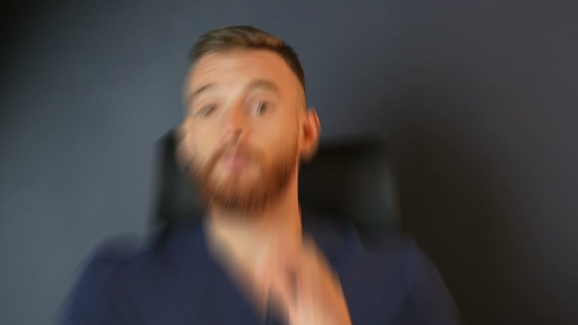

- **Cosa fa:** zoom rapido sugli occhi con la sfocatura di movimento e un piccolo superamento
- **Quando:** una parola che pesa («dico»)
- **Quando no:** su frasi lunghe
- **Reference:** gadzhi-04
- **Ultimo voto:** 7 (campionario v2, minimo 6)
- **Nel motore:** `{"camera": ["mosse"]}`
- **Origine:** campionario v1 e v2

### Taglio con lampo (`lampo`, attivo)

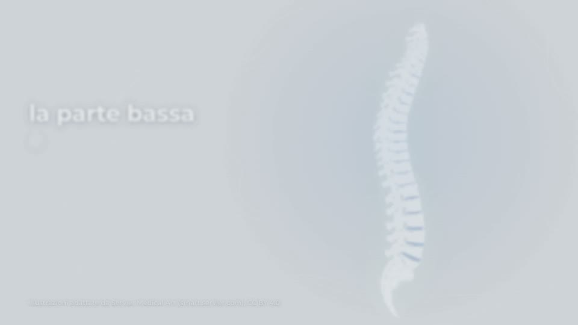

- **Cosa fa:** lampo di luce panna/verde di 3-4 frame fra lui e una scena scura
- **Quando:** entrata in una scena scura a tutto schermo
- **Quando no:** fra due momenti sul girato
- **Reference:** martell-02
- **Ultimo voto:** parte dei momenti a 7 (YT_POSTURA_32)
- **Nel motore:** `{"piatto": ["lampo"]}`
- **Origine:** YT_POSTURA_32

### Lui nel cerchio (`lui-nel-cerchio`, attivo)

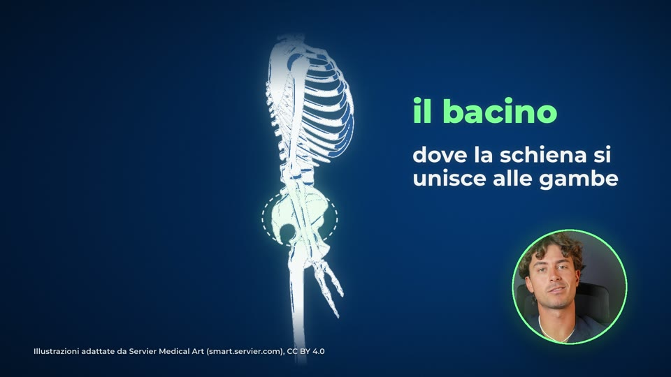

- **Cosa fa:** il quadro di lui si stacca, diventa un rettangolo tondo e poi un cerchio nell'angolo con l'anello verde; dietro entra la scena scura con il disegno
- **Quando:** passaggio da lui a una scena scura con un disegno Servier mentre lui continua a parlare
- **Quando no:** senza una scena scura dietro
- **Reference:** gadzhi-09
- **Ultimo voto:** 7 (campionario v3)
- **Nel motore:** `{"piatto": ["finestra.cerchio"]}`
- **Origine:** campionario v3
- **Nota:** fase 7c: la finestra si compone SOPRA gli strati del disegno (scena.componi), così lo scheletro entra mentre lui si stringe; prima entrava a cerchio già nell'angolo

### Finestra inclinata sul fondo del brand (`finestra-inclinata`, attivo)

- **Cosa fa:** il quadro diventa una finestra inclinata sul fondo del brand, con spazio grande per un testo forte
- **Quando:** call to action, link in descrizione
- **Quando no:** nei momenti di contenuto
- **Reference:** martell-06
- **Ultimo voto:** 8 (MR_POSTURA_01_v4, direttore, 02/11/2026)
- **Nel motore:** `{"piatto": ["finestra.inclina"]}`
- **Origine:** campionario v2, MR_POSTURA_01_v3

### B-roll pieno o in sequenza (`b-roll`, attivo)

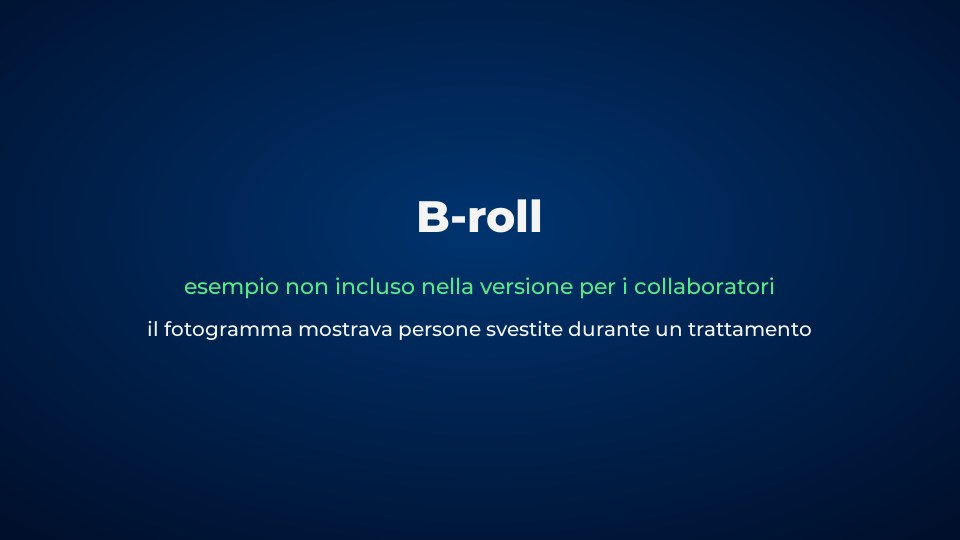

- **Cosa fa:** clip della libreria a tutto schermo o in sequenza, rallentate all'83%, senza audio, con un fruscio
- **Quando:** quando lui descrive una situazione
- **Quando no:** clip escluse dall'indice; mai sopra testo
- **Reference:** —
- **Ultimo voto:** —
- **Nel motore:** `{"regia": ["broll"]}`
- **Origine:** prima generazione, YT_POSTURA_32
- **Nota:** Esempio sostituito da un'immagine neutra nella v1.0 per i collaboratori: il fotogramma mostrava persone svestite durante un trattamento.

## testo sulla scena

### Frase sul corpo (`frase-sul-corpo`, attivo)

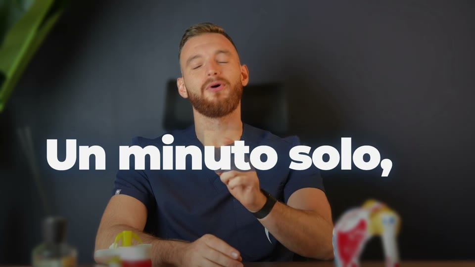

- **Cosa fa:** una o due parole enormi (800-900) sul busto, parola per parola sulla voce, le mani passano davanti alle lettere
- **Quando:** aggancio, una parola chiave da far pesare
- **Quando no:** frasi lunghe; quando le mani coprono troppo
- **Reference:** martell-02
- **Ultimo voto:** 8 (MR_POSTURA_01_v4, direttore, 02/11/2026)
- **Nel motore:** `{"modello": "parole"}`
- **Origine:** campionario v1 e v2
- **Nota:** fase 7c: ogni parola nasce sfocata e al 40% (5 frame) mentre sale dalla maschera: il primo frame non mostra piu solo le cime delle aste («U» -> «- -», direttore v4)

### Titolo dietro di lui (`titolo-dietro`, attivo)

- **Cosa fa:** il titolo di un capitolo passa dietro la persona (sagoma di Vision): minuscolo con il punto e la parola chiave in gradiente verde → azzurro, come il sito
- **Quando:** inizio di un capitolo, con le sue parole
- **Quando no:** testi lunghi; quando lui copre più del 15%
- **Reference:** martell-02
- **Ultimo voto:** 7 (YT_POSTURA_32)
- **Nel motore:** `{"modello": "titolo_dietro"}`
- **Origine:** prima generazione (Pillow), poi YT_POSTURA_32
- **Nota:** dal 01/11/2026 forma del sito (brand.json -> titoli): minuscolo con il punto, -0,045 em, interlinea 0,92, `dati.chiave` = parole in gradiente (default l'ultima riga). Il posto dietro di lui lo misura impagina.piazza_titolo sulle righe minuscole; se non trova un posto coperto 4-12% resta sulla parete (si segnala)

### Titolo dietro di lui (maiuscolo) (`titolo-dietro-maiuscolo`, variante)

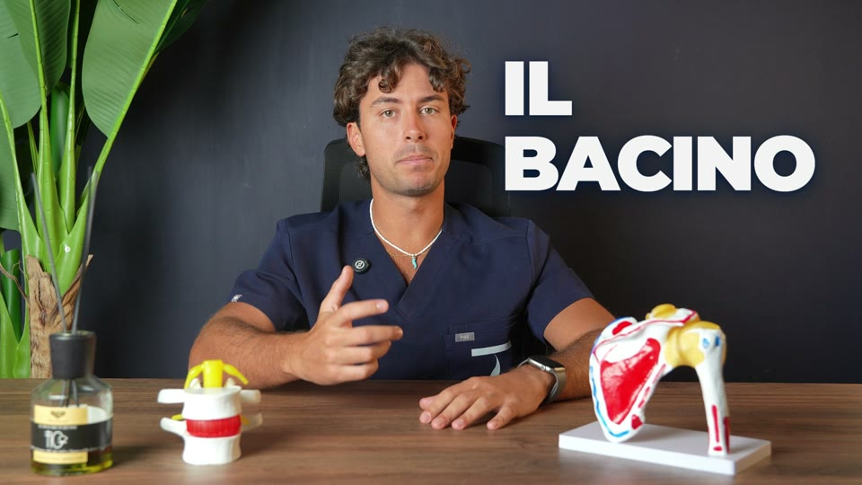

- **Cosa fa:** la versione di YT_POSTURA_32: titolo in MAIUSCOLO 900, tutto panna, passa dietro la persona
- **Quando:** —
- **Quando no:** —
- **Reference:** martell-02
- **Ultimo voto:** 7 (YT_POSTURA_32)
- **Nel motore:** `{"modello": "titolo_dietro", "dati": {"forma": "maiuscolo"}}`
- **Origine:** YT_POSTURA_32 (principale fino al 31/10/2026)
- **Variante di:** `titolo-dietro`
- **Nota:** variante dal 01/11/2026: il titolo principale segue il sito (minuscolo con il punto e la chiave in gradiente)

### Frase chiave nel vetro (più luce) (`frase-chiave-vetro`, attivo)

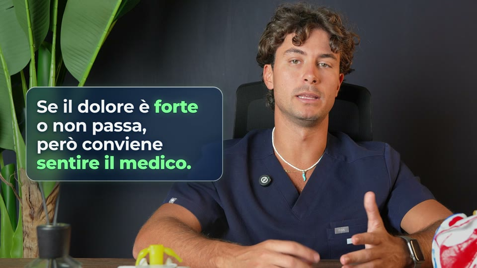

- **Cosa fa:** frase parola per parola dentro un vetro che sfoca lo studio, tinta blu, bordo di luce, riflesso diagonale, alone verde in entrata
- **Quando:** le frasi chiave (versione B scelta da Riccardo)
- **Quando no:** davanti al muro scuro: il vetro si legge come un riquadro
- **Condizioni (controllate dal motore):** vetro_zona_ricca
- **Reference:** martell-06
- **Ultimo voto:** 7 (campionario v3)
- **Nel motore:** `{"modello": "frase_luce", "dati": {"vetro": {"forte": true}}}`
- **Origine:** campionario v3

### Frase chiave nel vetro (classica) (`frase-chiave-vetro-classico`, variante)

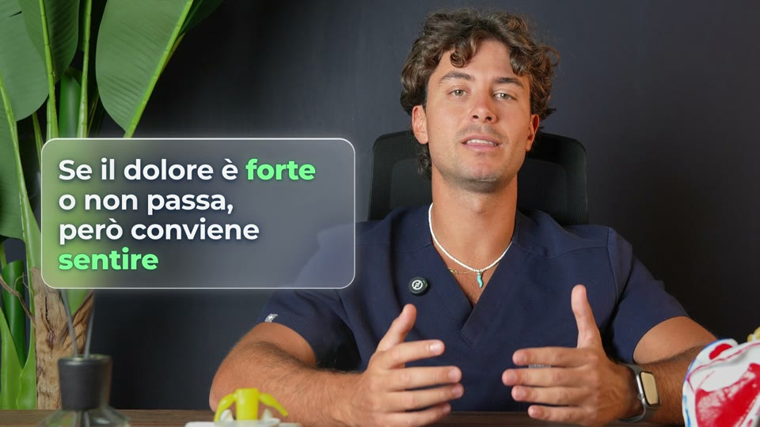

- **Cosa fa:** la versione di YT_POSTURA_32: vetro chiaro che schiarisce lo studio
- **Quando:** —
- **Quando no:** —
- **Reference:** martell-06
- **Ultimo voto:** 6-7 (YT_POSTURA_32)
- **Nel motore:** `{"modello": "frase_luce", "dati": {"vetro": {}}}`
- **Origine:** YT_POSTURA_32
- **Variante di:** `frase-chiave-vetro`

### Frase chiave nel pannello (versione A) (`frase-chiave-pannello`, variante)

- **Cosa fa:** pannello blu al bordo del quadro con la frase che sale riga per riga
- **Quando:** —
- **Quando no:** Riccardo ha scelto la versione B (vetro)
- **Reference:** martell-07
- **Ultimo voto:** — (campione tappa 2)
- **Nel motore:** `{"modello": "frase_chiave"}`
- **Origine:** campione di YT_POSTURA_32
- **Variante di:** `frase-chiave-vetro`

### Equazione detta (`equazione`, attivo)

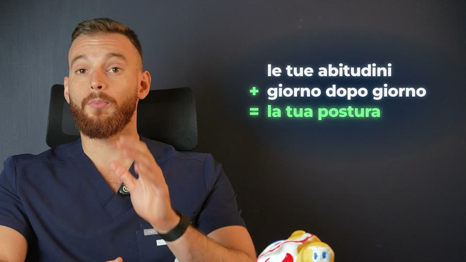

- **Cosa fa:** testo laterale: i termini detti si decifrano sulla voce, + e = verdi, esce cancellandosi all'indietro
- **Quando:** due o tre cose dette che si sommano in una conseguenza
- **Quando no:** sulla pianta o sul legno: sempre sulla parete libera con il velo blu
- **Reference:** gadzhi-10, gadzhi-13
- **Ultimo voto:** 8 (MR_POSTURA_01_v4, direttore, 02/11/2026)
- **Nel motore:** `{"modello": "equazione"}`
- **Origine:** campionario v3
- **Nota:** fase 7c: decifra = 'minuscole' per i termini lunghi (le maiuscole e i simboli provvisori allargano la parola di un terzo)

### Connettore (`connettore`, attivo)

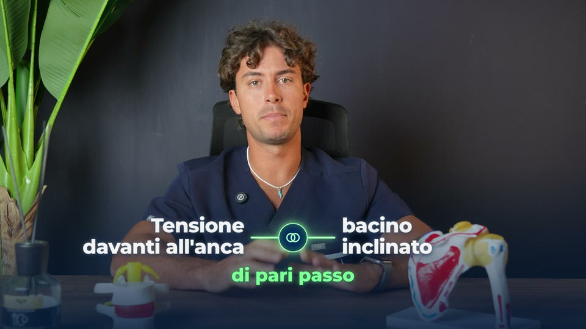

- **Cosa fa:** due etichette basse unite da una linea luminosa che si disegna dal centro, nodo con due anelli e le sue parole sotto
- **Quando:** due cose che lui lega («vanno di pari passo», «dipende da»)
- **Quando no:** quando sotto ci sono mani, oggetti o modellini
- **Condizioni (controllate dal motore):** zona_libera
- **Reference:** gadzhi-11
- **Ultimo voto:** 7 (campionario v3)
- **Nel motore:** `{"modello": "connettore"}`
- **Origine:** campionario v3

### Chip con nome e ruolo (`chip`, attivo)

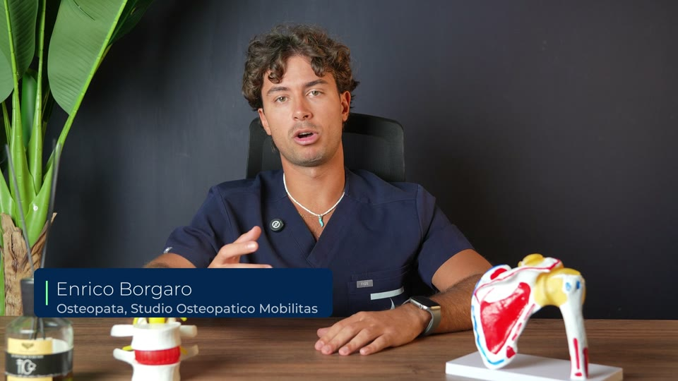

- **Cosa fa:** nome e ruolo di chi parla; dal 01/11/2026 con il pittogramma su un disco panna
- **Quando:** alla presentazione
- **Quando no:** nomi non confermati dai materiali
- **Reference:** —
- **Ultimo voto:** —
- **Nel motore:** `{"grafica": ["chip"]}`
- **Origine:** prima generazione
- **Nota:** regia.chip.stile: v3 = pittogramma su disco panna, nome 700, ruolo al 70% (v2 resta per i video vecchi)

## numeri

### Numero gigante dietro di lui (`numero-dietro`, attivo)

- **Cosa fa:** un numero detto da lui, enorme, dietro la persona (sagoma di Vision), che conta e frena sulla parola
- **Quando:** un numero detto (recensioni, addominali, ore)
- **Quando no:** numeri non detti, percentuali di risultato
- **Reference:** martell-02, gadzhi-03
- **Ultimo voto:** 8 (MR_POSTURA_01_v4, direttore, 02/11/2026)
- **Nel motore:** `{"modello": "numero_dietro"}`
- **Origine:** campionario v1 e v2

### Linea del tempo luminosa (`linea-tempo`, attivo)

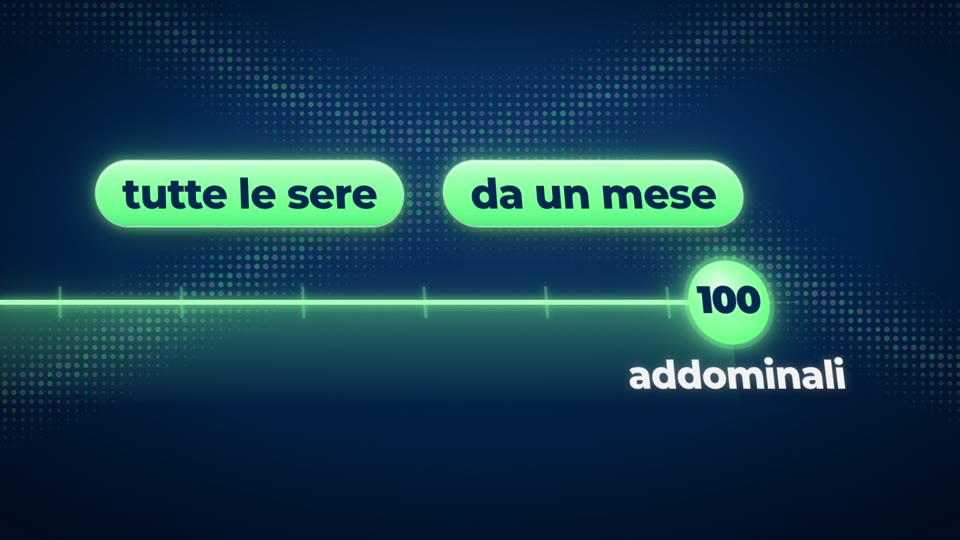

- **Cosa fa:** scena scura: un nodo verde disegna una linea mentre la percorre, la camera lo segue inclinata, pillole con le sue parole
- **Quando:** solo quando lui dice un tempo o una durata
- **Quando no:** per inventare un dato o una curva
- **Condizioni (controllate dal motore):** tempo_detto
- **Reference:** gadzhi-07
- **Ultimo voto:** 6 (campionario v3)
- **Nel motore:** `{"modello": "linea_tempo"}`
- **Origine:** campionario v3

## scene scure

### Schermata su fondo blu vero (`schermata`, attivo)

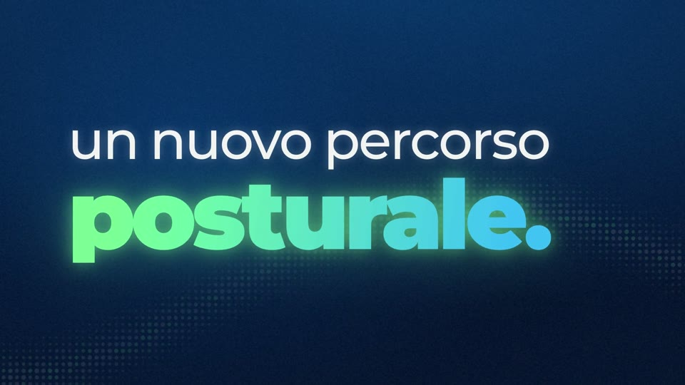

- **Cosa fa:** frase a tutto schermo su fondo blu pieno con il retino, parole che nascono sfocate e si accendono, colpo di scala sulla chiave
- **Quando:** frasi che chiudono un passaggio
- **Quando no:** più di due per video
- **Reference:** martell-07
- **Ultimo voto:** 8 (MR_POSTURA_01_v4, direttore, 02/11/2026)
- **Nel motore:** `{"modello": "schermata", "dati": {"fondo": "pieno"}}`
- **Origine:** campionario v3 (principale dal 01/11/2026)
- **Nota:** dal 01/11/2026: fondo del sito, parole minuscole con il punto, chiave in gradiente con la luce verde; chiavi di fila sulla stessa riga con un gradiente continuo

### Schermata sul velo (classica) (`schermata-velo`, variante)

- **Cosa fa:** frase a tutto schermo su un velo blu sopra il girato sfocato, parole che salgono dalle maschere, filigrana MOBILITAS
- **Quando:** quando si vuole lasciare intravedere lui
- **Quando no:** —
- **Reference:** martell-07
- **Ultimo voto:** 6 (YT_POSTURA_32)
- **Nel motore:** `{"modello": "schermata"}`
- **Origine:** campionario v1 e v2, YT_POSTURA_32
- **Variante di:** `schermata`

## liste

### Etichette barrate (più luce) (`etichette-barrate`, attivo)

- **Cosa fa:** pillole piene di luce verde con il testo blu notte; la barra blu notte le barra sulla parola e restano accese
- **Quando:** i tentativi o le idee che lui smonta
- **Quando no:** cose che non smonta
- **Reference:** martell-01
- **Ultimo voto:** 8 (MR_POSTURA_01_v4, direttore, 02/11/2026)
- **Nel motore:** `{"modello": "etichette_luce", "dati": {"luce": "forte"}}`
- **Origine:** campionario v3 (principale dal 01/11/2026)
- **Nota:** fase 7c: barra = 'panna' -> barra panna che sporge e pillola barrata che scende al 38% e perde colore (sulla pillola verde la barra blu notte non si distingueva)

### Etichette barrate (classiche) (`etichette-barrate-classiche`, variante)

- **Cosa fa:** pillole blu notte con bordo e bagliore verdi; barrate si spengono
- **Quando:** —
- **Quando no:** —
- **Reference:** martell-01
- **Ultimo voto:** 7 (YT_POSTURA_32)
- **Nel motore:** `{"modello": "etichette_luce", "dati": {"luce": "classica"}}`
- **Origine:** YT_POSTURA_32
- **Variante di:** `etichette-barrate`

### Lista dei tentativi (`tentativi`, variante)

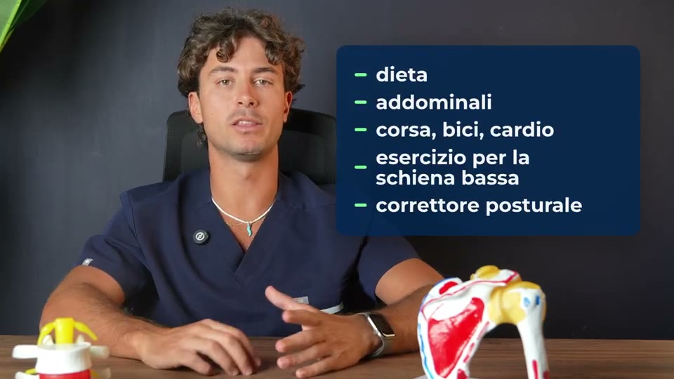

- **Cosa fa:** colonna di voci con tratto che le barra
- **Quando:** —
- **Quando no:** —
- **Reference:** martell-01
- **Ultimo voto:** — (campione tappa 2)
- **Nel motore:** `{"modello": "tentativi"}`
- **Origine:** YT_POSTURA_32 tappa 1
- **Variante di:** `etichette-barrate`

### Riga di icone in basso (`riga-icone`, attivo)

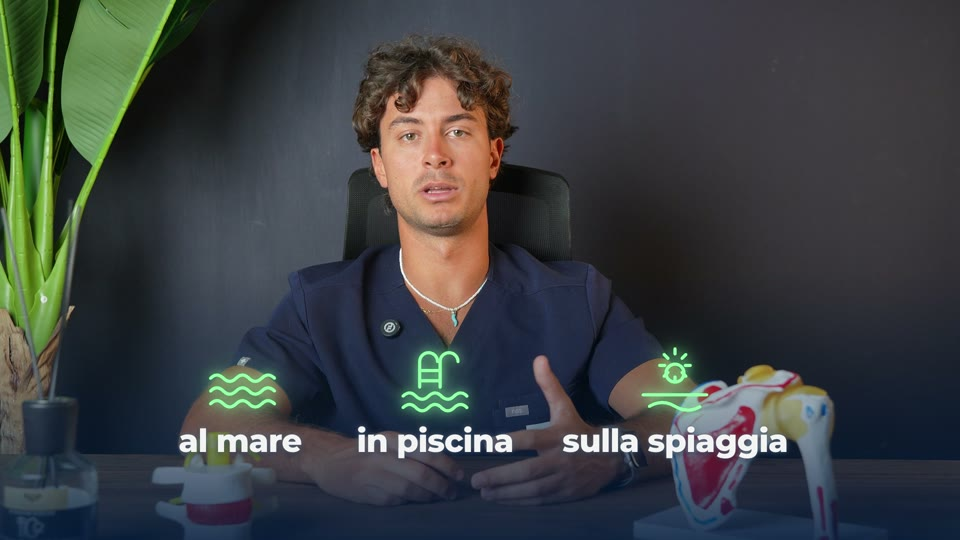

- **Cosa fa:** icone lineari verdi che si disegnano sulla parola con l'etichetta sotto, velo blu dal basso
- **Quando:** tre luoghi, oggetti o momenti detti in fila
- **Quando no:** quando la parte bassa ha mani, oggetti o modellini; figure umane
- **Condizioni (controllate dal motore):** zona_libera
- **Reference:** gadzhi-14
- **Ultimo voto:** 7 (campionario v3)
- **Nel motore:** `{"modello": "riga_icone"}`
- **Origine:** campionario v3

### Card che si accendono (`card-accese`, attivo)

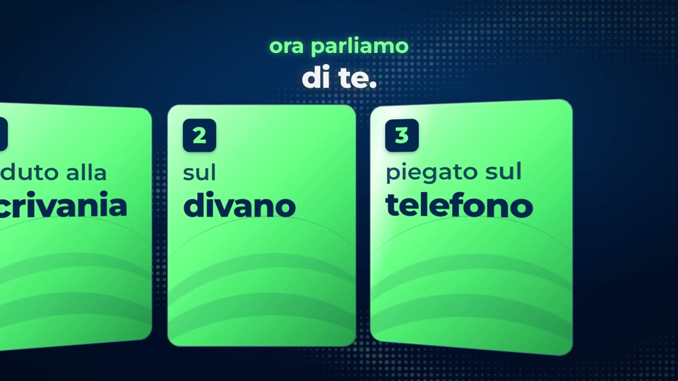

- **Cosa fa:** scena scura: tre card 3D arrivano nascoste con una scansione e si accendono quando lui le nomina, poi riepilogo
- **Quando:** elenchi di tre cose annunciate prima
- **Quando no:** elenchi lunghi
- **Reference:** gadzhi-08/09/12/15
- **Ultimo voto:** 8 (MR_POSTURA_01_v4, direttore, 02/11/2026)
- **Nel motore:** `{"modello": "card_accese"}`
- **Origine:** campionario v3
- **Nota:** fase 7c: cifre = false toglie le cifre a contorno (il «1» si leggeva come una freccia)

### Card con spessore (`card-con-spessore`, attivo)

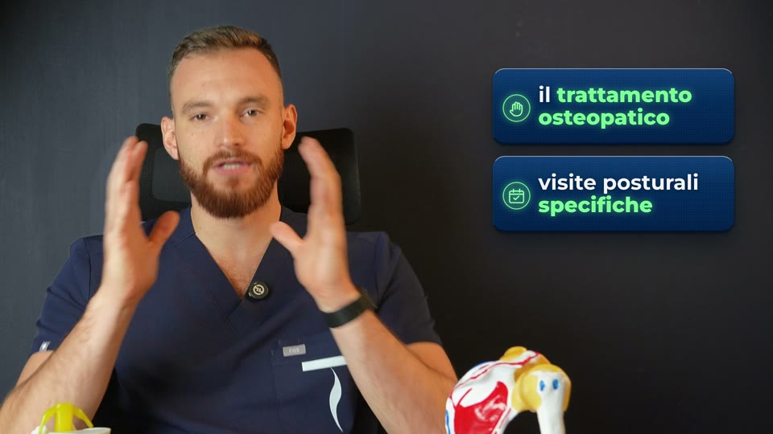

- **Cosa fa:** card blu notte con spessore, una ogni 0,25 s, con icona o ritaglio Servier
- **Quando:** elenchi brevi accanto a lui
- **Quando no:** sopra mani o volto
- **Reference:** gadzhi-06
- **Ultimo voto:** 8 (MR_POSTURA_01_v4, direttore, 02/11/2026)
- **Nel motore:** `{"modello": "card_spessore"}`
- **Origine:** YT_POSTURA_32
- **Nota:** ; fase 7c: senza disegno Servier, `icona` (lineare verde su disco blu notte); attenzione: il testo deve stare in due righe (la card taglia il testo che va a capo una terza volta, e il controllo «lettere intere» non lo vede)

### Card vicino alle mani (`card-fluttuanti`, attivo)

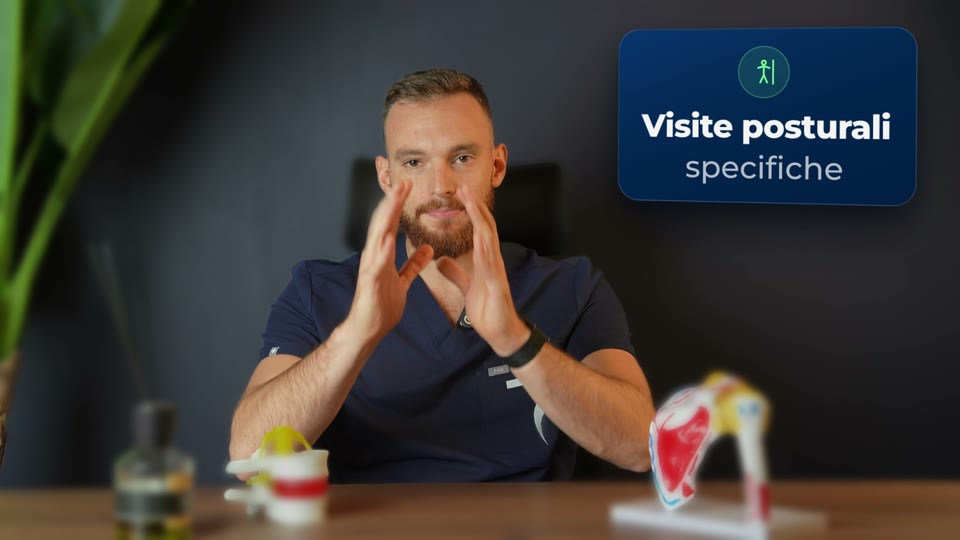

- **Cosa fa:** card che nascono sulla mano vera (Vision) e volano al loro posto
- **Quando:** due cose dette in fila
- **Quando no:** quando le mani sono al centro e le card dovrebbero coprirle
- **Reference:** gadzhi-06
- **Ultimo voto:** 8 (MR_POSTURA_01_v4, direttore, 02/11/2026)
- **Nel motore:** `{"modello": "card"}`
- **Origine:** campionario v1 e v2

### Card dietro la spalla (`card-dietro-la-spalla`, attivo)

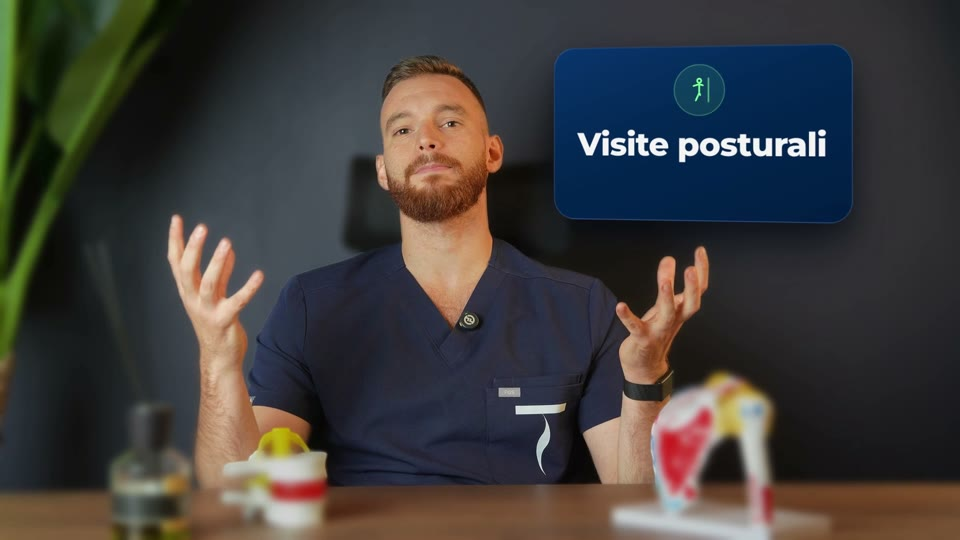

- **Cosa fa:** come le card vicino alle mani, ma la seconda passa dietro la spalla (profondità)
- **Quando:** come le card
- **Quando no:** —
- **Reference:** gadzhi-06
- **Ultimo voto:** 8 (MR_POSTURA_01_v4, direttore, 02/11/2026)
- **Nel motore:** `{"modello": "card", "dati": {"dietro": true}}`
- **Origine:** campionario v2, MR_POSTURA_01_v3

### Fumetti dei pensieri (`fumetti`, attivo)

- **Cosa fa:** fumetti chiari con coda e luce interna, uno per frase, i precedenti salgono
- **Quando:** i pensieri che si dice da solo
- **Quando no:** frasi che non sono pensieri
- **Reference:** martell-05
- **Ultimo voto:** 7 (YT_POSTURA_32)
- **Nel motore:** `{"modello": "fumetti"}`
- **Origine:** YT_POSTURA_32

## chiamata all'azione

### Lista d'attesa (`lista-attesa`, attivo)

- **Cosa fa:** righe che compaiono spente e si accendono sulla parola, in una finestra sul fondo del brand
- **Quando:** lista d'attesa, posti
- **Quando no:** —
- **Reference:** gadzhi-04
- **Ultimo voto:** 8 (MR_POSTURA_01_v4, direttore, 02/11/2026)
- **Nel motore:** `{"modello": "lista_attesa"}`
- **Origine:** campionario v1 e v2
- **Nota:** dal 01/11/2026 titolo nella forma del sito (forma: classica = variante)

### Lista d'attesa (classica) (`lista-attesa-classica`, variante)

- **Cosa fa:** la versione di MR_POSTURA_01_v3: titolo «Lista d'attesa» in Title Case, tutto panna
- **Quando:** —
- **Quando no:** —
- **Reference:** gadzhi-04
- **Ultimo voto:** 6 (campionario v2)
- **Nel motore:** `{"modello": "lista_attesa", "dati": {"forma": "classica"}}`
- **Origine:** campionario v1 e v2
- **Variante di:** `lista-attesa`
- **Nota:** variante dal 01/11/2026: il modello principale segue il brand del sito (minuscolo con il punto, chiave in gradiente)

### Link in descrizione (`cta-link`, attivo)

- **Cosa fa:** «Link in descrizione» grande con una freccia verde che cade e rimbalza
- **Quando:** quando lui rimanda alla descrizione
- **Quando no:** nei video senza link
- **Reference:** gadzhi-04
- **Ultimo voto:** 8 (MR_POSTURA_01_v4, direttore, 02/11/2026)
- **Nel motore:** `{"modello": "cta"}`
- **Origine:** campionario v1 e v2
- **Nota:** dal 01/11/2026 forma del sito: minuscolo con il punto, l'ultima parola in gradiente (forma: classica = variante)

### Link in descrizione (classica) (`cta-link-classica`, variante)

- **Cosa fa:** la versione di MR_POSTURA_01_v3: «Link in descrizione» in Title Case, tutto panna
- **Quando:** —
- **Quando no:** —
- **Reference:** gadzhi-04
- **Ultimo voto:** 6 (campionario v2)
- **Nel motore:** `{"modello": "cta", "dati": {"forma": "classica"}}`
- **Origine:** campionario v1 e v2
- **Variante di:** `cta-link`
- **Nota:** variante dal 01/11/2026: il modello principale segue il brand del sito (minuscolo con il punto, chiave in gradiente)

### Card e schermata di chiusura (`chiusura`, attivo)

- **Cosa fa:** card dietro la spalla, poi schermata piena con marchio, testo e freccia
- **Quando:** fine dei mid-roll
- **Quando no:** —
- **Reference:** martell-02
- **Ultimo voto:** 8 (MR_POSTURA_01_v4, direttore, 02/11/2026)
- **Nel motore:** `{"modello": "chiusura"}`
- **Origine:** MR_POSTURA_01_v3
- **Nota:** dal 01/11/2026 forma del sito e pittogramma su disco panna sopra il logo (forma: classica = variante)

### Chiusura (classica) (`chiusura-classica`, variante)

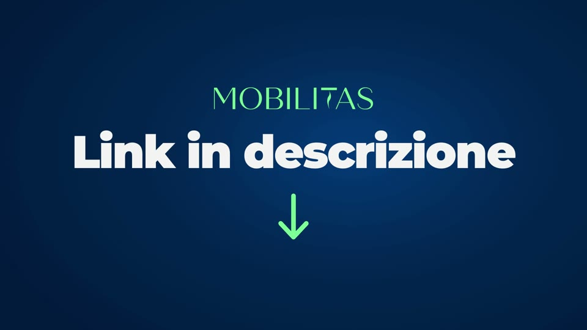

- **Cosa fa:** la versione di MR_POSTURA_01_v3: logo e «Link in descrizione» senza pittogramma
- **Quando:** —
- **Quando no:** —
- **Reference:** martell-02
- **Ultimo voto:** parte del voto 8 di MR_POSTURA_01_v3
- **Nel motore:** `{"modello": "chiusura", "dati": {"forma": "classica"}}`
- **Origine:** MR_POSTURA_01_v3
- **Variante di:** `chiusura`
- **Nota:** variante dal 01/11/2026: il modello principale segue il brand del sito (minuscolo con il punto, chiave in gradiente)

### Schermata finale YouTube (`schermata-finale-youtube`, attivo)

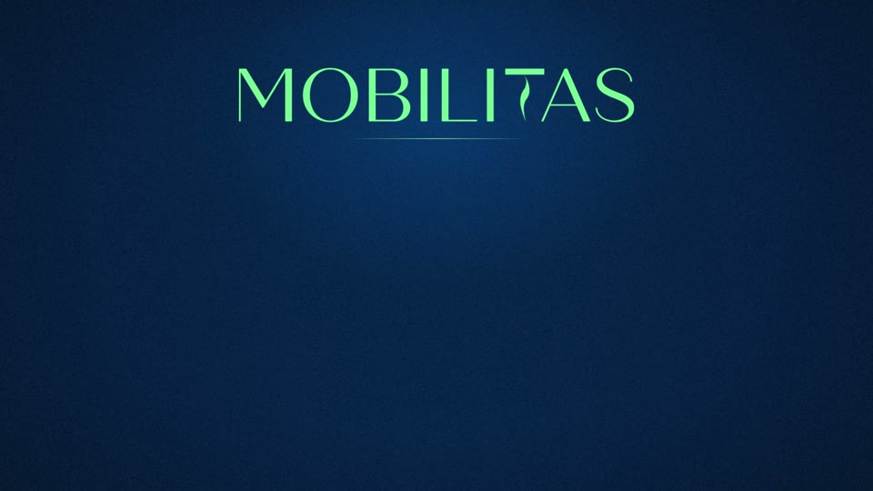

- **Cosa fa:** 12 s dopo l'ultima parola: fondo del brand, logo, pittogramma su disco panna, zone libere per gli elementi di YouTube
- **Quando:** fine dei video YouTube
- **Quando no:** mid-roll
- **Reference:** —
- **Ultimo voto:** — (approvata con il video YT_POSTURA_32)
- **Nel motore:** `{"regia": ["scena.coda"]}`
- **Origine:** YT_POSTURA_32 tappa 3

## oggetti veri

### Telefono in prospettiva (app vera) (`telefono-prospettiva`, attivo)

- **Cosa fa:** telefono in prospettiva con le schermate vere dell'app, messa a fuoco e colpo di camera
- **Quando:** quando lui parla dell'app
- **Quando no:** schermate con dati di persone, importi o frasi sulla salute non sfocati; telefono grande che copre lui
- **Reference:** martell-06
- **Ultimo voto:** 7 (MR_POSTURA_01_v4, direttore, 02/11/2026) — dopo il quinto giro il profilo l'ho verificato io
- **Nel motore:** `{"modello": "telefono3d"}`
- **Origine:** campionario v1 e v2
- **Nota:** render dell'app scontornati dal motore (titolo: false, tieni_bianco: true per i render senza titolo e con card bianche). fase 7c: entrata = 'posto' -> nasce dove sta (niente viaggio da fuori quadro, che non passa il controllo del quadro: anche in MR_POSTURA_01_v3), cambio di schermata sul posto, alone verde tenue dietro; piu schermate cambiano sul posto, ognuna sulle sue parole; `sfoca`: [[x0, y0, x1, y1], ...] (px del file) sfoca le righe con dati di persone, importi o frasi sulla salute (Riccardo, 02/11/2026: tutte le foto dell'app, in modo estetico e minimale)

### Telefono con la sagoma (`telefono-sagoma`, vietato)

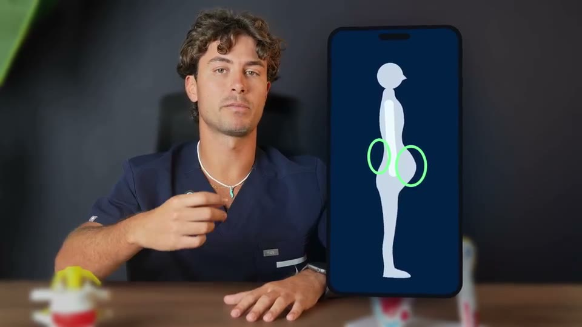

- **Cosa fa:** telefono con una «foto» fatta dalla sagoma disegnata
- **Quando:** mai
- **Quando no:** mai: bocciato da Riccardo
- **Reference:** —
- **Ultimo voto:** bocciato
- **Nel motore:** `{"modello": "telefono3d", "dati": {"genera": "foto_sagoma"}}`
- **Origine:** YT_POSTURA_32 tappa 1

### Foto vera in card (`foto-card`, attivo)

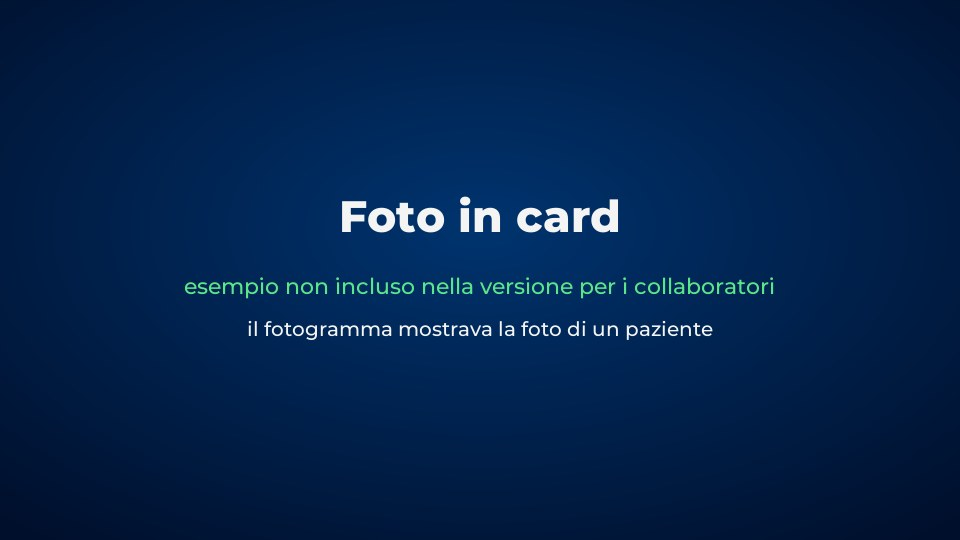

- **Cosa fa:** foto vera di un paziente (consenso nel catalogo), viso tagliato fuori, in card; solo PRIMA e DOPO come testo
- **Quando:** quando lui parla di come si vede di lato
- **Quando no:** senza consenso; con tempi o risultati scritti
- **Reference:** martell-06
- **Ultimo voto:** 6 (YT_POSTURA_32)
- **Nel motore:** `{"modello": "foto_card"}`
- **Origine:** YT_POSTURA_32
- **Nota:** Esempio sostituito da un'immagine neutra nella v1.0 per i collaboratori: il fotogramma mostrava la foto di un paziente.

### Prima/dopo con cursore (`prima-dopo-cursore`, attivo)

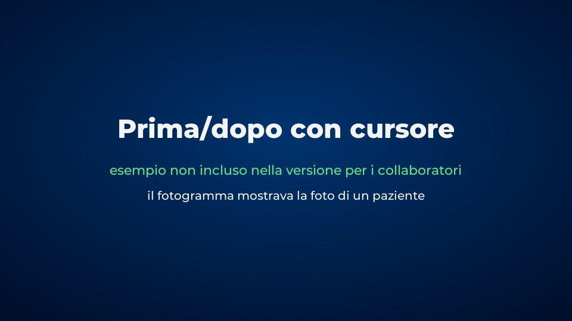

- **Cosa fa:** due foto del paziente (data EXIF), PRIMA a sinistra e DOPO a destra, linea posturale di Vision, cursore
- **Quando:** quando lui parla dei risultati dello studio, senza promesse
- **Quando no:** senza consenso; foto quasi uguali
- **Reference:** gadzhi-05
- **Ultimo voto:** 7 (MR_POSTURA_01_v4, direttore, 02/11/2026)
- **Nel motore:** `{"modello": "confronto"}`
- **Origine:** campionario v1 e v2
- **Nota:** fase 7c: cursore.modo = 'meta' -> fermo a meta dall'entrata (PRIMA e DOPO sempre leggibili), poi una sola corsa fino a `fino`. Esempio sostituito da un'immagine neutra nella v1.0 per i collaboratori: il fotogramma mostrava la foto di un paziente.

## anatomia

### Anatomia Servier in card (`anatomia-card`, attivo)

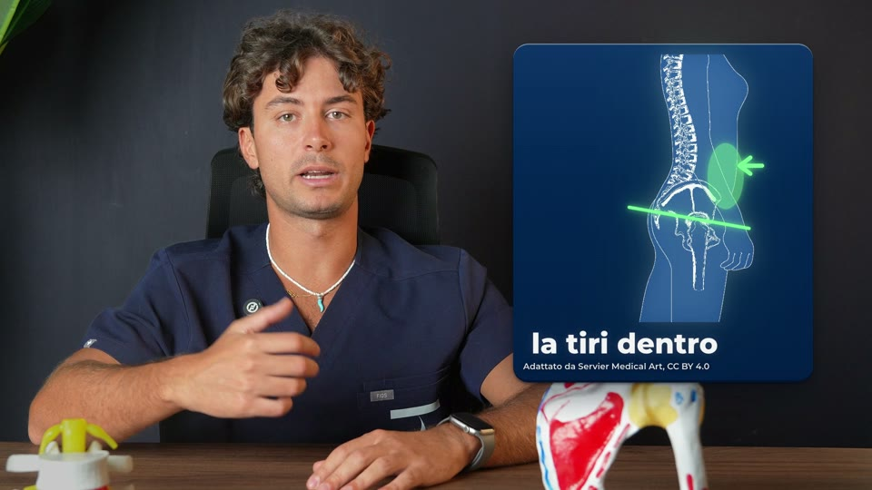

- **Cosa fa:** disegno Servier ricolorato in una card accanto a lui, aloni, frecce, assi, etichette sulla voce, attribuzione
- **Quando:** un meccanismo detto, accanto a lui
- **Quando no:** aggiunte cliniche non dette
- **Reference:** martell-06, gadzhi-06
- **Ultimo voto:** 7 (YT_POSTURA_32)
- **Nel motore:** `{"modello": "anatomia", "dati": {"pannello": "card"}}`
- **Origine:** YT_POSTURA_32

### Anatomia Servier in scena scura (`anatomia-scena`, attivo)

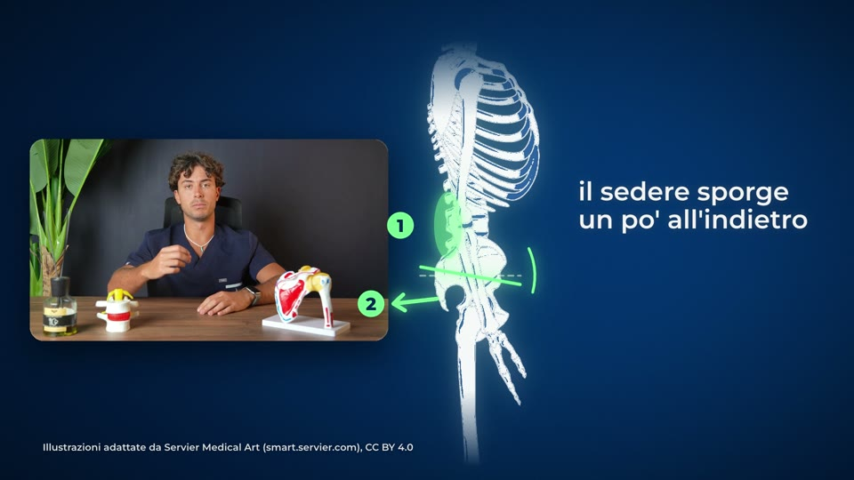

- **Cosa fa:** disegno Servier a tutto schermo su fondo scuro, camera che si muove fra le parti, lui in finestra o in cerchio
- **Quando:** il meccanismo centrale del video
- **Quando no:** più di 2-3 volte per video
- **Reference:** martell-07
- **Ultimo voto:** 7 (YT_POSTURA_32)
- **Nel motore:** `{"modello": "anatomia", "dati": {"pannello": "pieno"}}`
- **Origine:** YT_POSTURA_32

## vietati

### Sagoma vettoriale (`sagoma-vettoriale`, vietato)

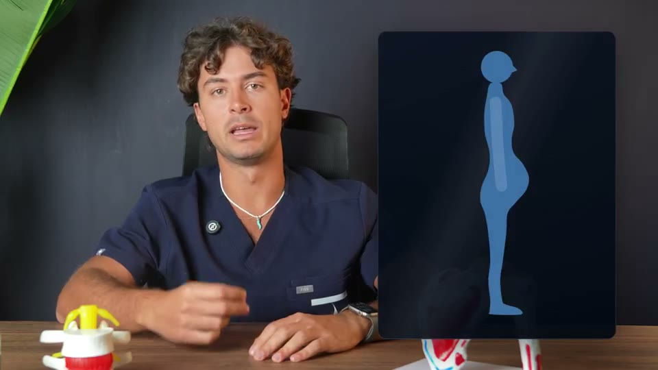

- **Cosa fa:** figura umana disegnata da noi (profilo posturale)
- **Quando:** mai
- **Quando no:** mai: bocciata da Riccardo (niente figure umane disegnate)
- **Reference:** —
- **Ultimo voto:** bocciata
- **Nel motore:** `{"modello": "sagoma"}`
- **Origine:** YT_POSTURA_32 tappa 1 e inserti di MR_POSTURA_01_v2

### Sagoma a pannello (prima generazione) (`inserto-sagoma`, vietato)

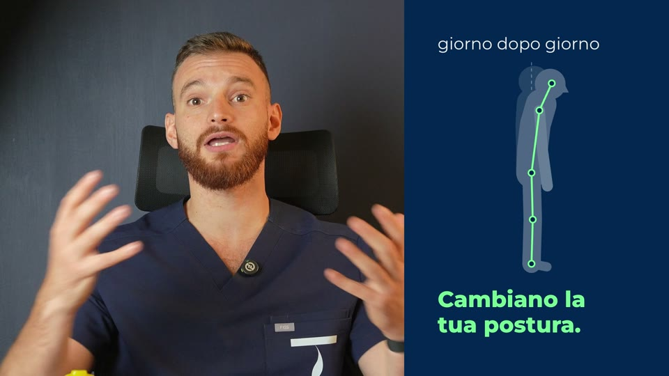

- **Cosa fa:** profilo posturale disegnato su pannello
- **Quando:** mai
- **Quando no:** mai: bocciata da Riccardo
- **Reference:** —
- **Ultimo voto:** bocciata
- **Nel motore:** `{"inserto": "sagoma"}`
- **Origine:** MR_POSTURA_01_v2

## prima generazione

### Aggancio a pannello (prima generazione) (`inserto-aggancio`, variante)

- **Cosa fa:** frase d'apertura su un pannello accanto alla persona, con il logo
- **Quando:** —
- **Quando no:** —
- **Reference:** —
- **Ultimo voto:** — (MR_POSTURA_01_v2)
- **Nel motore:** `{"inserto": "aggancio"}`
- **Origine:** MR_POSTURA_01_v2
- **Variante di:** `frase-sul-corpo`

### Numero a pannello (prima generazione) (`inserto-numero`, variante)

- **Cosa fa:** numero che conta su un pannello accanto alla persona
- **Quando:** —
- **Quando no:** —
- **Reference:** —
- **Ultimo voto:** — (MR_POSTURA_01_v2)
- **Nel motore:** `{"inserto": "numero"}`
- **Origine:** MR_POSTURA_01_v2
- **Variante di:** `numero-dietro`

### Prodotto a pannello (prima generazione) (`inserto-prodotto`, variante)

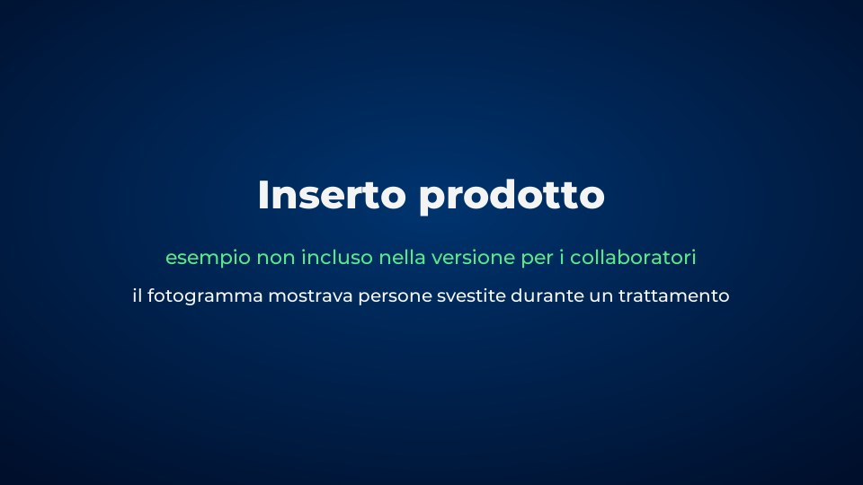

- **Cosa fa:** voci del servizio su un pannello
- **Quando:** —
- **Quando no:** —
- **Reference:** —
- **Ultimo voto:** — (MR_POSTURA_01_v2)
- **Nel motore:** `{"inserto": "prodotto"}`
- **Origine:** MR_POSTURA_01_v2
- **Variante di:** `card-fluttuanti`
- **Nota:** Esempio sostituito da un'immagine neutra nella v1.0 per i collaboratori: il fotogramma mostrava persone svestite durante un trattamento.

### Telefono a pannello (prima generazione) (`inserto-telefono`, variante)

- **Cosa fa:** schermate dell'app in un telefono piatto sul pannello
- **Quando:** —
- **Quando no:** —
- **Reference:** —
- **Ultimo voto:** — (MR_POSTURA_01_v2)
- **Nel motore:** `{"inserto": "telefono"}`
- **Origine:** MR_POSTURA_01_v2
- **Variante di:** `telefono-prospettiva`

### Prima/dopo a pannello (prima generazione) (`inserto-primadopo`, variante)

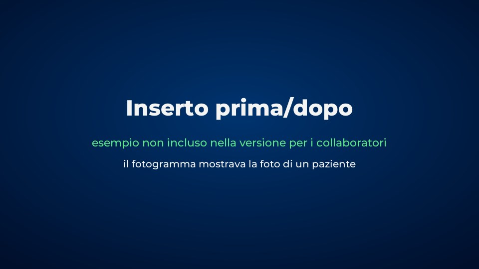

- **Cosa fa:** due foto affiancate con la linea posturale su blu profondo
- **Quando:** —
- **Quando no:** —
- **Reference:** —
- **Ultimo voto:** — (MR_POSTURA_01_v2)
- **Nel motore:** `{"inserto": "primadopo"}`
- **Origine:** MR_POSTURA_01_v2
- **Variante di:** `prima-dopo-cursore`
- **Nota:** Esempio sostituito da un'immagine neutra nella v1.0 per i collaboratori: il fotogramma mostrava la foto di un paziente.

### Lista a pannello (prima generazione) (`inserto-lista`, variante)

- **Cosa fa:** lista d'attesa in più tempi su un pannello
- **Quando:** —
- **Quando no:** —
- **Reference:** —
- **Ultimo voto:** — (MR_POSTURA_01_v2)
- **Nel motore:** `{"inserto": "lista"}`
- **Origine:** MR_POSTURA_01_v2
- **Variante di:** `lista-attesa`

### Scelte a pannello (prima generazione) (`inserto-scelte`, variante)

- **Cosa fa:** due o tre scelte su un pannello
- **Quando:** —
- **Quando no:** —
- **Reference:** —
- **Ultimo voto:** — (MR_POSTURA_01_v2)
- **Nel motore:** `{"inserto": "scelte"}`
- **Origine:** MR_POSTURA_01_v2
- **Variante di:** `card-fluttuanti`

### Modulo stilizzato (prima generazione) (`inserto-modulo`, variante)

- **Cosa fa:** campi vuoti che si evidenziano quando li nomina
- **Quando:** —
- **Quando no:** —
- **Reference:** —
- **Ultimo voto:** — (MR_POSTURA_01_v2)
- **Nel motore:** `{"inserto": "modulo"}`
- **Origine:** MR_POSTURA_01_v2
- **Variante di:** `cta-link`

### Chiusura a pannello (prima generazione) (`inserto-chiusura`, variante)

- **Cosa fa:** pannello che si allarga a tutto schermo dopo l'ultima parola
- **Quando:** —
- **Quando no:** —
- **Reference:** —
- **Ultimo voto:** — (MR_POSTURA_01_v2)
- **Nel motore:** `{"inserto": "chiusura"}`
- **Origine:** MR_POSTURA_01_v2
- **Variante di:** `chiusura`

### Look caldo (`look-caldo`, variante)

- **Cosa fa:** correzione colore calda sul girato
- **Quando:** —
- **Quando no:** Riccardo: look originale, nessuna correzione del girato
- **Reference:** —
- **Ultimo voto:** — (campionario v1)
- **Nel motore:** `{"piatto": ["look_caldo"]}`
- **Origine:** campionario v1

### Look profondo (`look-profondo`, variante)

- **Cosa fa:** correzione colore profonda sul girato
- **Quando:** —
- **Quando no:** Riccardo: look originale, nessuna correzione del girato
- **Reference:** —
- **Ultimo voto:** — (campionario v1)
- **Nel motore:** `{"piatto": ["look_profondo"]}`
- **Origine:** campionario v1

